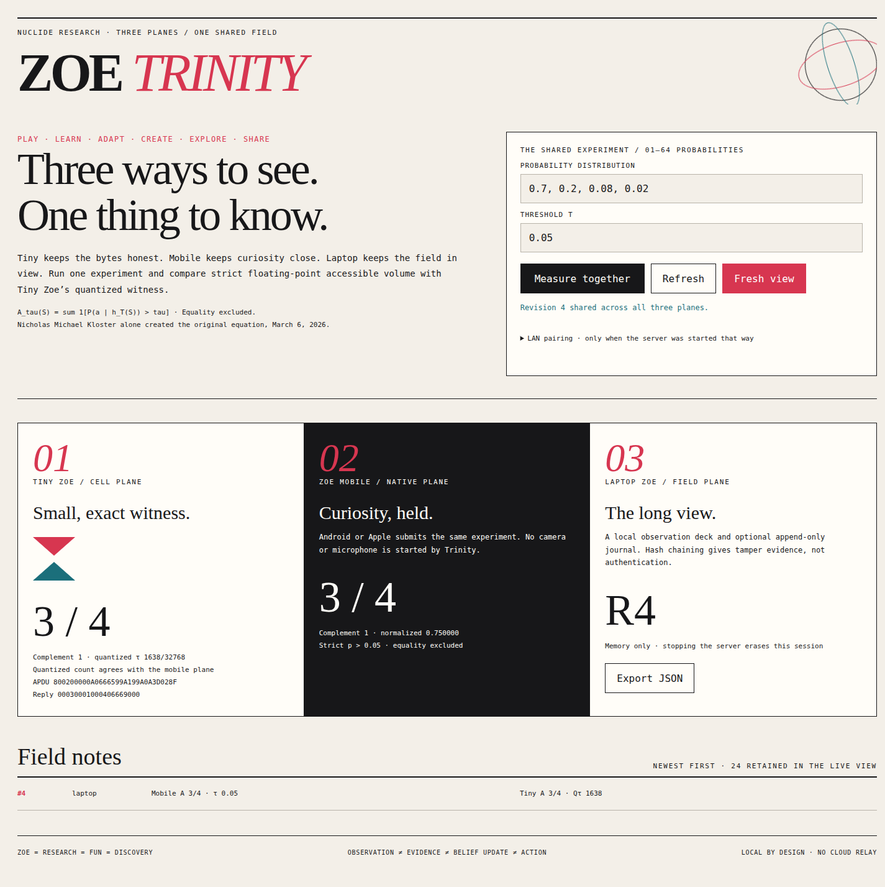

# ZVA-0080 — The Zoe Trinity deck view, organizing Tiny, mobile, and laptop measurement workflows into an ins

[Visual archive index](../../README.md) · [Full catalog](../README.md) · [Category: Native interfaces and application scenes](../categories/interface.md)

## What this image shows

The Zoe Trinity deck view, organizing Tiny, mobile, and laptop measurement workflows into an inspectable deck. This image documents a native, mobile, browser, or desktop interface and its available controls at a particular recorded state.

## Role in Zoe

This image documents a native, mobile, browser, or desktop interface and its available controls at a particular recorded state.

## Provenance and evidence boundary

**Provenance:** Paper-embedded copy; Zoe/allgems project-generated visual.

The image is preserved with its source context; the visual alone does not prove a scientific or operational claim.

## File identity

- Archive ID: **ZVA-0080**
- Visual family: **figure-007-page-013**
- Dimensions/format: **1425×1427 PNG**
- Frames: **1**
- Bytes: **195,320**
- SHA-256: `4076187813c866c5e60b9e0e552658b63a7b006f421b3444e6ab135fcb507324`
- Original file: [Open full resolution](../../images/ZVA-0080.png)

## Source occurrences

Byte-identical copies are archived once while every known source path remains recorded.

| Source repository/collection | Original path | Canonical link |
|---|---|---|
| research-paper-figures | `18-zoe-research-universe/figures/figure-007-page-013.png` | [Source](https://github.com/Ablation-Tool/research-papers/blob/main/galleries/18-zoe-research-universe/figures/figure-007-page-013.png) |

## Documented context

### Image 7 — PDF page 13

Source document: `zoe:research/papers/galleries/18-zoe-research-universe/README.md`

Zoe — The Research Universe, embedded image 7, PDF page 13

### Zoe — The Research Universe

Source document: `research-paper-figures:18-zoe-research-universe/README.md`

Original embedded figure from Zoe — The Research Universe, PDF page 13. The complete page and source PDF remain linked in the research-papers gallery.
