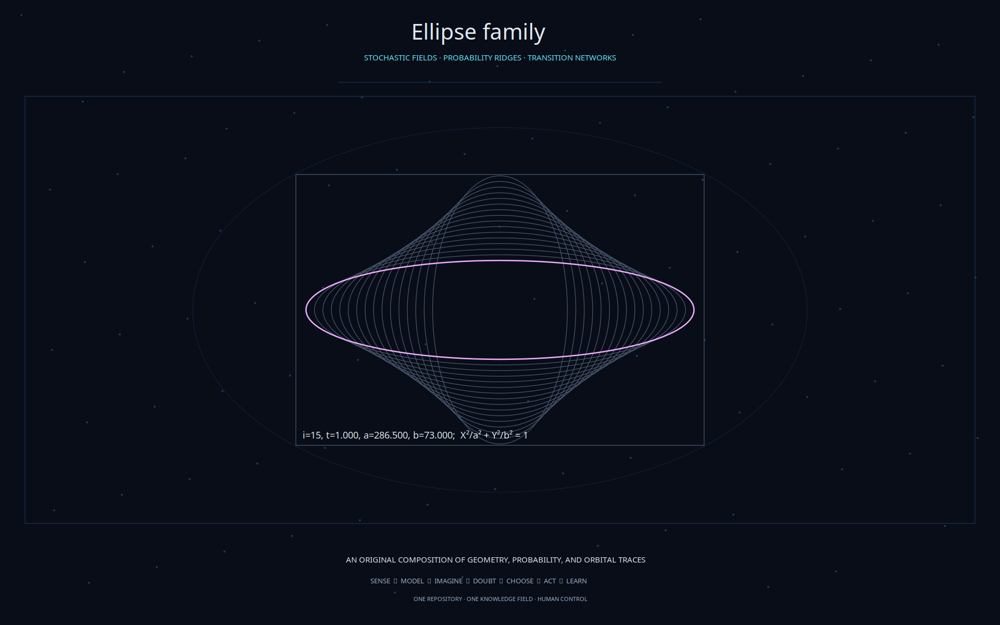

# ZVA-0082 — The original “Lots of Ellipses” composition: GDPEMANY-inspired ellipse families, stochastic fiel

[Visual archive index](../../README.md) · [Full catalog](../README.md) · [Category: Artwork and generative compositions](../categories/artwork.md)

## What this image shows

The original “Lots of Ellipses” composition: GDPEMANY-inspired ellipse families, stochastic fields, probability ridges, transition networks, and orbital traces combined as creative geometry.

## Role in Zoe

This is part of Zoe’s creative geometry and generative-art practice, preserving the artistic side of the project alongside its scientific instruments.

## Provenance and evidence boundary

**Provenance:** Paper-embedded copy; Zoe/allgems project-generated visual.

The image is preserved with its source context; the visual alone does not prove a scientific or operational claim.

## File identity

- Archive ID: **ZVA-0082**
- Visual family: **figure-009-page-015**
- Dimensions/format: **1920×1200 PNG**
- Frames: **1**
- Bytes: **211,268**
- SHA-256: `82441b41549881e5476551093e4c836cf1a6e081eb4188615ecf48bd84c4935d`
- Original file: [Open full resolution](../../images/ZVA-0082.png)

## Source occurrences

Byte-identical copies are archived once while every known source path remains recorded.

| Source repository/collection | Original path | Canonical link |
|---|---|---|
| research-paper-figures | `18-zoe-research-universe/figures/figure-009-page-015.png` | [Source](https://github.com/Ablation-Tool/research-papers/blob/main/galleries/18-zoe-research-universe/figures/figure-009-page-015.png) |

## Documented context

### Image 9 — PDF page 15

Source document: `zoe:research/papers/galleries/18-zoe-research-universe/README.md`

Zoe — The Research Universe, embedded image 9, PDF page 15

### Zoe — The Research Universe

Source document: `research-paper-figures:18-zoe-research-universe/README.md`

Original embedded figure from Zoe — The Research Universe, PDF page 15. The complete page and source PDF remain linked in the research-papers gallery.
