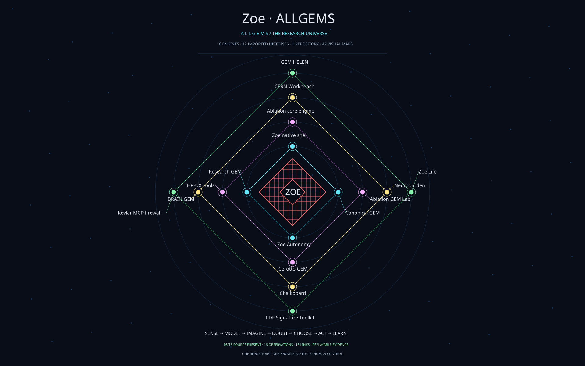

# ZVA-0083 — The unified Zoe knowledge-engineering hub with the current woven-diamond vector emblem, sixteen

[Visual archive index](../../README.md) · [Full catalog](../README.md) · [Category: Research figures and measurements](../categories/research-figure.md)

## What this image shows

The unified Zoe knowledge-engineering hub with the current woven-diamond vector emblem, sixteen registered engines, one repository, and the replayable knowledge field. This figure preserves a measurement, model output, simulation, geometric construction, or research explanation from the Zoe/allgems program.

## Role in Zoe

This figure preserves a measurement, model output, simulation, geometric construction, or research explanation from the Zoe/allgems program.

## Provenance and evidence boundary

**Provenance:** Paper-embedded copy; Zoe/allgems project-generated visual.

The image is preserved with its source context; the visual alone does not prove a scientific or operational claim.

## File identity

- Archive ID: **ZVA-0083**
- Visual family: **figure-010-page-021**
- Dimensions/format: **1920×1200 PNG**
- Frames: **1**
- Bytes: **204,113**
- SHA-256: `06741dc6b43663f732a197bc3d023970e3caa26468c75e6e0dd8b6d3a4592e74`
- Original file: [Open full resolution](../../images/ZVA-0083.png)

## Source occurrences

Byte-identical copies are archived once while every known source path remains recorded.

| Source repository/collection | Original path | Canonical link |
|---|---|---|
| research-paper-figures | `18-zoe-research-universe/figures/figure-010-page-021.png` | [Source](https://github.com/Ablation-Tool/research-papers/blob/main/galleries/18-zoe-research-universe/figures/figure-010-page-021.png) |

## Documented context

### Image 10 — PDF page 21

Source document: `zoe:research/papers/galleries/18-zoe-research-universe/README.md`

Zoe — The Research Universe, embedded image 10, PDF page 21

### Zoe — The Research Universe

Source document: `research-paper-figures:18-zoe-research-universe/README.md`

Original embedded figure from Zoe — The Research Universe, PDF page 21. The complete page and source PDF remain linked in the research-papers gallery.
