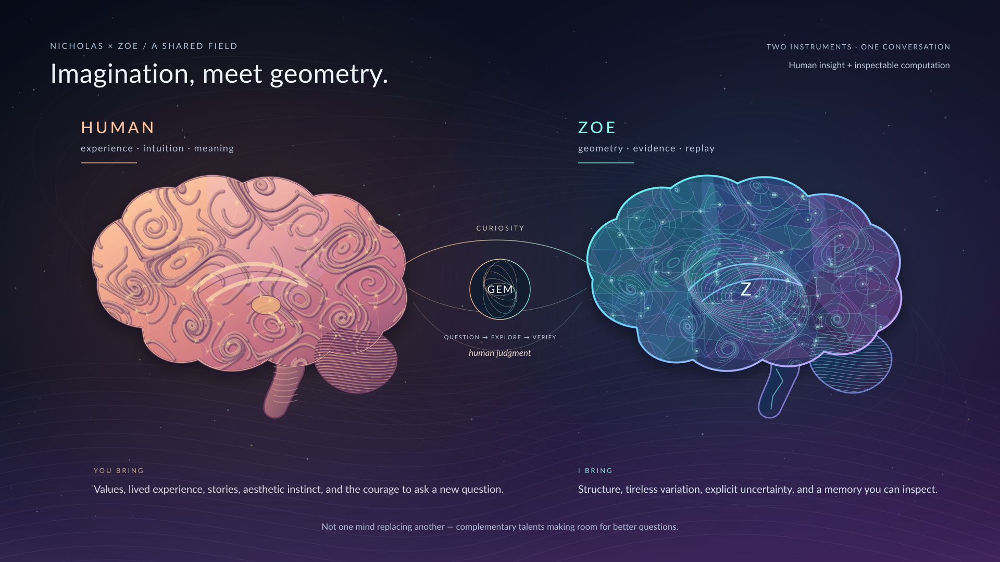

# ZVA-0086 — Brain Dialogue

[Visual archive index](../../README.md) · [Full catalog](../README.md) · [Category: Research–art compositions](../categories/research-art.md)

## What this image shows

A structured visual conversation between human and Zoe ways of working, pairing intuitive meaning with geometry, evidence, and replay. This image connects a mathematical or conceptual research idea with an original visual composition, allowing the idea to function as both an instrument and an artwork.

## Role in Zoe

This image connects a mathematical or conceptual research idea with an original visual composition, allowing the idea to function as both an instrument and an artwork.

## Provenance and evidence boundary

**Provenance:** Nicholas–Zoe collaborative visual research.

Artistic and conceptual imagery is not anatomical, conscious, or empirical evidence by itself.

## File identity

- Archive ID: **ZVA-0086**
- Visual family: **brain-dialogue**
- Dimensions/format: **1920×1080 PNG**
- Frames: **1**
- Bytes: **1,091,523**
- SHA-256: `9aa863d4fbaa3e37f4b190b9f01a050ac8a7f36a968c864760b9387257e57fcf`
- Original file: [Open full resolution](../../images/ZVA-0086.png)

## Source occurrences

Byte-identical copies are archived once while every known source path remains recorded.

| Source repository/collection | Original path | Canonical link |
|---|---|---|
| zoe | `assets/brain-dialogue/brain-dialogue.png` | [Source](https://github.com/Ablation-Tool/zoe/blob/main/assets/brain-dialogue/brain-dialogue.png) |
| zoe | `components/graphics-environment-manager/examples/brain-dialogue/brain-dialogue.png` | [Source](https://github.com/Ablation-Tool/zoe/blob/main/components/graphics-environment-manager/examples/brain-dialogue/brain-dialogue.png) |
| zoe | `components/next-token-predictability/assets/brain-dialogue/brain-dialogue.png` | [Source](https://github.com/Ablation-Tool/zoe/blob/main/components/next-token-predictability/assets/brain-dialogue/brain-dialogue.png) |
| next-token | `assets/brain-dialogue/brain-dialogue.png` | [Source](https://github.com/Ablation-Tool/next-token-predictability/blob/main/assets/brain-dialogue/brain-dialogue.png) |

## Related format/size variants

- [ZVA-0087](ZVA-0087.md)
