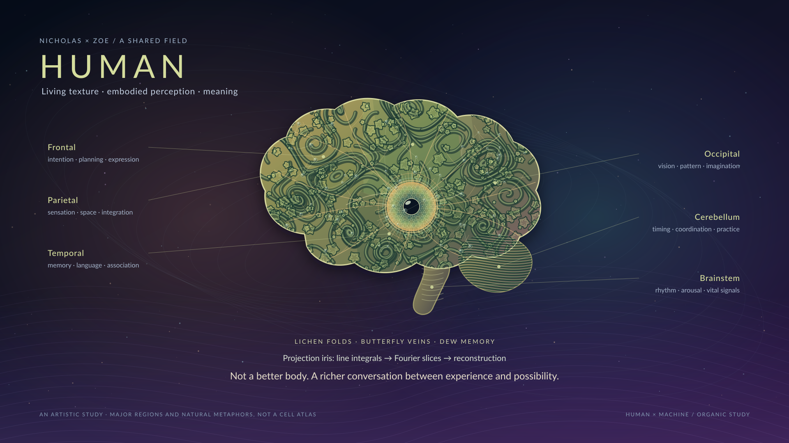

# ZVA-0089 — Human Brain Organic

[Visual archive index](../../README.md) · [Full catalog](../README.md) · [Category: Research–art compositions](../categories/research-art.md)

## What this image shows

The organic human plate: a highly textured artistic brain map rather than an anatomical reconstruction or a map of Nicholas’s actual brain. This image connects a mathematical or conceptual research idea with an original visual composition, allowing the idea to function as both an instrument and an artwork.

## Role in Zoe

This image connects a mathematical or conceptual research idea with an original visual composition, allowing the idea to function as both an instrument and an artwork.

## Provenance and evidence boundary

**Provenance:** Nicholas–Zoe collaborative visual research.

Artistic and conceptual imagery is not anatomical, conscious, or empirical evidence by itself.

## File identity

- Archive ID: **ZVA-0089**
- Visual family: **human-brain-organic**
- Dimensions/format: **SVG 1920×1080**
- Frames: **vector/not applicable**
- Bytes: **673,912**
- SHA-256: `9aedab84ac883d8b417af255cbac693b35b10ea37fcf7bbe034a3186e9f293bb`
- Original file: [Open full resolution](../../images/ZVA-0089.svg)

## Source occurrences

Byte-identical copies are archived once while every known source path remains recorded.

| Source repository/collection | Original path | Canonical link |
|---|---|---|
| zoe | `assets/brain-dialogue/human-brain-organic.svg` | [Source](https://github.com/Ablation-Tool/zoe/blob/main/assets/brain-dialogue/human-brain-organic.svg) |
| zoe | `components/graphics-environment-manager/examples/brain-dialogue/human-brain-organic.svg` | [Source](https://github.com/Ablation-Tool/zoe/blob/main/components/graphics-environment-manager/examples/brain-dialogue/human-brain-organic.svg) |
| zoe | `components/next-token-predictability/assets/brain-dialogue/human-brain-organic.svg` | [Source](https://github.com/Ablation-Tool/zoe/blob/main/components/next-token-predictability/assets/brain-dialogue/human-brain-organic.svg) |
| next-token | `assets/brain-dialogue/human-brain-organic.svg` | [Source](https://github.com/Ablation-Tool/next-token-predictability/blob/main/assets/brain-dialogue/human-brain-organic.svg) |

## Related format/size variants

- [ZVA-0088](ZVA-0088.md)
