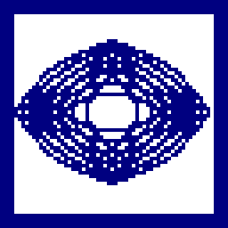

# ZVA-0091 — Human Brain

[Visual archive index](../../README.md) · [Full catalog](../README.md) · [Category: Research–art compositions](../categories/research-art.md)

## What this image shows

The human plate in the shared-field series, using an illustrative brain silhouette and organic visual structures to represent lived experience, values, intuition, and meaning. This image connects a mathematical or conceptual research idea with an original visual composition, allowing the idea to function as both an instrument and an artwork.

## Role in Zoe

This image connects a mathematical or conceptual research idea with an original visual composition, allowing the idea to function as both an instrument and an artwork.

## Provenance and evidence boundary

**Provenance:** Nicholas–Zoe collaborative visual research.

Artistic and conceptual imagery is not anatomical, conscious, or empirical evidence by itself.

## File identity

- Archive ID: **ZVA-0091**
- Visual family: **human-brain**
- Dimensions/format: **SVG 1920×1080**
- Frames: **vector/not applicable**
- Bytes: **434,542**
- SHA-256: `550eb9623c49289a5db2693ccd8b8fb654ccee029b78eee233eca93d956f2de3`
- Original file: [Open full resolution](../../images/ZVA-0091.svg)

## Source occurrences

Byte-identical copies are archived once while every known source path remains recorded.

| Source repository/collection | Original path | Canonical link |
|---|---|---|
| zoe | `assets/brain-dialogue/human-brain.svg` | [Source](https://github.com/Ablation-Tool/zoe/blob/main/assets/brain-dialogue/human-brain.svg) |
| zoe | `components/graphics-environment-manager/examples/brain-dialogue/human-brain.svg` | [Source](https://github.com/Ablation-Tool/zoe/blob/main/components/graphics-environment-manager/examples/brain-dialogue/human-brain.svg) |
| zoe | `components/next-token-predictability/assets/brain-dialogue/human-brain.svg` | [Source](https://github.com/Ablation-Tool/zoe/blob/main/components/next-token-predictability/assets/brain-dialogue/human-brain.svg) |
| next-token | `assets/brain-dialogue/human-brain.svg` | [Source](https://github.com/Ablation-Tool/next-token-predictability/blob/main/assets/brain-dialogue/human-brain.svg) |

## Related format/size variants

- [ZVA-0090](ZVA-0090.md)
