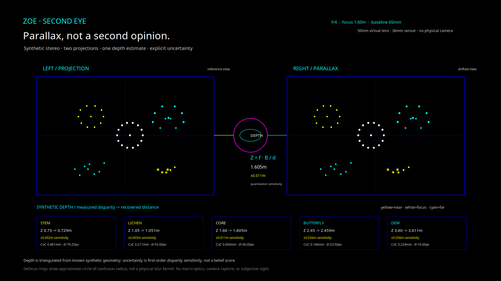

# ZVA-0094 — Second Eye

[Visual archive index](../../README.md) · [Full catalog](../README.md) · [Category: Research–art compositions](../categories/research-art.md)

## What this image shows

Two calibrated synthetic pinhole views showing parallax, depth, focus, and disparity-sensitivity controls. The scene visualizes geometry rather than subjective sight or a second model opinion.

## Role in Zoe

This image connects a mathematical or conceptual research idea with an original visual composition, allowing the idea to function as both an instrument and an artwork.

## Provenance and evidence boundary

**Provenance:** Nicholas–Zoe collaborative visual research.

Artistic and conceptual imagery is not anatomical, conscious, or empirical evidence by itself.

## File identity

- Archive ID: **ZVA-0094**
- Visual family: **second-eye**
- Dimensions/format: **1920×1080 PNG**
- Frames: **1**
- Bytes: **91,506**
- SHA-256: `affae29c81605d5d6f10cb622af5046ebd9779cebae656e1f747193d280ddb79`
- Original file: [Open full resolution](../../images/ZVA-0094.png)

## Source occurrences

Byte-identical copies are archived once while every known source path remains recorded.

| Source repository/collection | Original path | Canonical link |
|---|---|---|
| zoe | `assets/brain-dialogue/second-eye.png` | [Source](https://github.com/Ablation-Tool/zoe/blob/main/assets/brain-dialogue/second-eye.png) |
| zoe | `components/Zoe-Autonomy/paper/unified/figures/second-eye.png` | [Source](https://github.com/Ablation-Tool/zoe/blob/main/components/Zoe-Autonomy/paper/unified/figures/second-eye.png) |
| zoe | `components/graphics-environment-manager/docs/images/zoe-second-eye.png` | [Source](https://github.com/Ablation-Tool/zoe/blob/main/components/graphics-environment-manager/docs/images/zoe-second-eye.png) |
| zoe | `components/next-token-predictability/assets/brain-dialogue/second-eye.png` | [Source](https://github.com/Ablation-Tool/zoe/blob/main/components/next-token-predictability/assets/brain-dialogue/second-eye.png) |
| zoe | `components/next-token-predictability/paper/unified/figures/second-eye.png` | [Source](https://github.com/Ablation-Tool/zoe/blob/main/components/next-token-predictability/paper/unified/figures/second-eye.png) |
| zoe-autonomy | `paper/unified/figures/second-eye.png` | [Source](https://github.com/Ablation-Tool/Zoe-Autonomy/blob/main/paper/unified/figures/second-eye.png) |
| next-token | `assets/brain-dialogue/second-eye.png` | [Source](https://github.com/Ablation-Tool/next-token-predictability/blob/main/assets/brain-dialogue/second-eye.png) |
| next-token | `paper/unified/figures/second-eye.png` | [Source](https://github.com/Ablation-Tool/next-token-predictability/blob/main/paper/unified/figures/second-eye.png) |
| paper-source-figures | `02-unified-autonomy/figures/second-eye.png` | [Source](https://github.com/Ablation-Tool/research-papers) |

## Documented context

### Install the numerical runtime for mirrored forecasts.

Source document: `zoe:components/graphics-environment-manager/README.md`

Zoe's second eye

Original manuals stay in place. PDFs without text layers are reported rather than presented as searchable; unsupported files are not executed. See the library guide, cognition architecture, and verification evidence. Zoe's second eye: parallax and depth of field

## Related format/size variants

- [ZVA-0095](ZVA-0095.md)
