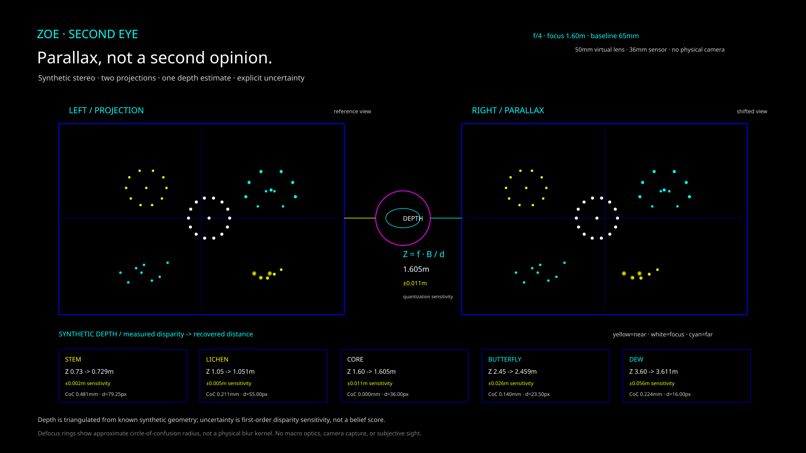

# ZVA-0095 — Second Eye

[Visual archive index](../../README.md) · [Full catalog](../README.md) · [Category: Research–art compositions](../categories/research-art.md)

## What this image shows

Two calibrated synthetic pinhole views showing parallax, depth, focus, and disparity-sensitivity controls. The scene visualizes geometry rather than subjective sight or a second model opinion.

## Role in Zoe

This image connects a mathematical or conceptual research idea with an original visual composition, allowing the idea to function as both an instrument and an artwork.

## Provenance and evidence boundary

**Provenance:** Nicholas–Zoe collaborative visual research.

Artistic and conceptual imagery is not anatomical, conscious, or empirical evidence by itself.

## File identity

- Archive ID: **ZVA-0095**
- Visual family: **second-eye**
- Dimensions/format: **SVG 1920×1080**
- Frames: **vector/not applicable**
- Bytes: **95,918**
- SHA-256: `234f22197f78bdd1774b37f1b4d41ade74cc3027fe8e9f94188602694caa693e`
- Original file: [Open full resolution](../../images/ZVA-0095.svg)

## Source occurrences

Byte-identical copies are archived once while every known source path remains recorded.

| Source repository/collection | Original path | Canonical link |
|---|---|---|
| zoe | `assets/brain-dialogue/second-eye.svg` | [Source](https://github.com/Ablation-Tool/zoe/blob/main/assets/brain-dialogue/second-eye.svg) |
| zoe | `components/graphics-environment-manager/docs/images/zoe-second-eye.svg` | [Source](https://github.com/Ablation-Tool/zoe/blob/main/components/graphics-environment-manager/docs/images/zoe-second-eye.svg) |
| zoe | `components/next-token-predictability/assets/brain-dialogue/second-eye.svg` | [Source](https://github.com/Ablation-Tool/zoe/blob/main/components/next-token-predictability/assets/brain-dialogue/second-eye.svg) |
| next-token | `assets/brain-dialogue/second-eye.svg` | [Source](https://github.com/Ablation-Tool/next-token-predictability/blob/main/assets/brain-dialogue/second-eye.svg) |

## Related format/size variants

- [ZVA-0094](ZVA-0094.md)
