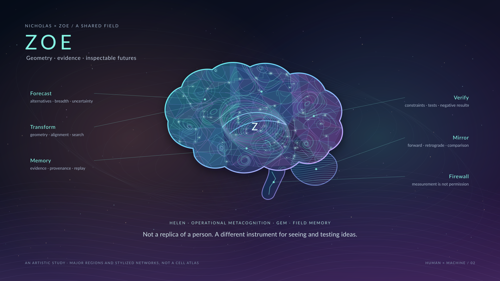

# ZVA-0097 — Zoe Brain

[Visual archive index](../../README.md) · [Full catalog](../README.md) · [Category: Research–art compositions](../categories/research-art.md)

## What this image shows

The Zoe plate in the shared-field series, using explicit partitions, mirrored forecast paths, nested futures, and inspectable evidence connections. This image connects a mathematical or conceptual research idea with an original visual composition, allowing the idea to function as both an instrument and an artwork.

## Role in Zoe

This image connects a mathematical or conceptual research idea with an original visual composition, allowing the idea to function as both an instrument and an artwork.

## Provenance and evidence boundary

**Provenance:** Nicholas–Zoe collaborative visual research.

Artistic and conceptual imagery is not anatomical, conscious, or empirical evidence by itself.

## File identity

- Archive ID: **ZVA-0097**
- Visual family: **zoe-brain**
- Dimensions/format: **SVG 1920×1080**
- Frames: **vector/not applicable**
- Bytes: **201,416**
- SHA-256: `9627f73356aaa552f1582e5302d2cc08279cd4d017de5d5243661e3b517c279e`
- Original file: [Open full resolution](../../images/ZVA-0097.svg)

## Source occurrences

Byte-identical copies are archived once while every known source path remains recorded.

| Source repository/collection | Original path | Canonical link |
|---|---|---|
| zoe | `assets/brain-dialogue/zoe-brain.svg` | [Source](https://github.com/Ablation-Tool/zoe/blob/main/assets/brain-dialogue/zoe-brain.svg) |
| zoe | `components/graphics-environment-manager/examples/brain-dialogue/zoe-brain.svg` | [Source](https://github.com/Ablation-Tool/zoe/blob/main/components/graphics-environment-manager/examples/brain-dialogue/zoe-brain.svg) |
| zoe | `components/next-token-predictability/assets/brain-dialogue/zoe-brain.svg` | [Source](https://github.com/Ablation-Tool/zoe/blob/main/components/next-token-predictability/assets/brain-dialogue/zoe-brain.svg) |
| next-token | `assets/brain-dialogue/zoe-brain.svg` | [Source](https://github.com/Ablation-Tool/next-token-predictability/blob/main/assets/brain-dialogue/zoe-brain.svg) |

## Related format/size variants

- [ZVA-0096](ZVA-0096.md)
- [ZVA-0361](ZVA-0361.md)
- [ZVA-0362](ZVA-0362.md)
