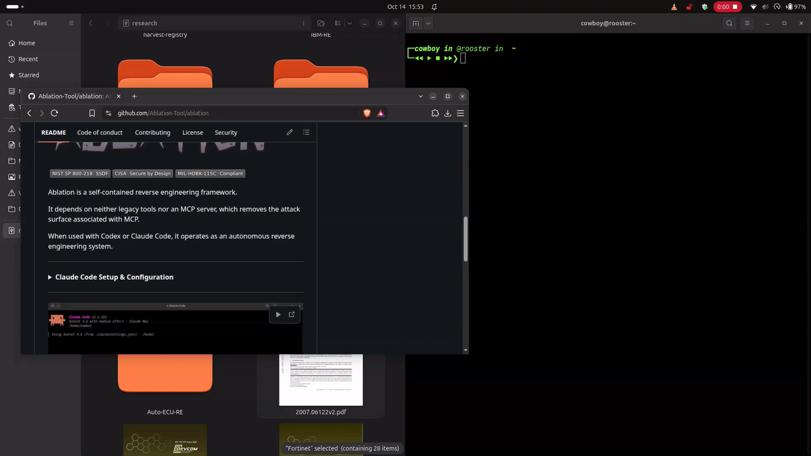

# ZVA-0098 — Nick+zoe

[Visual archive index](../../README.md) · [Full catalog](../README.md) · [Category: Animations and historical motion assets](../categories/animation.md)

## What this image shows

One of four supplied historical GIF names preserved in the branding archive. All four names have identical content bytes, so this is one recorded animation with four occurrence names rather than four distinct works.

## Role in Zoe

This historical motion asset is retained as part of the project’s visual provenance, including duplicate-name and duplicate-content relationships.

## Provenance and evidence boundary

**Provenance:** User-supplied historical motion asset.

The supplied GIF names must not be interpreted as distinct animations when their bytes are identical.

## File identity

- Archive ID: **ZVA-0098**
- Visual family: **nick+zoe**
- Dimensions/format: **256×256 GIF**
- Frames: **140**
- Bytes: **6,156,703**
- SHA-256: `72f319b68610d6c425b1ac40daee1bc9128eb454f95fe1b5c9b3daef319231ae`
- Original file: [Open full resolution](../../images/ZVA-0098.gif)

## Source occurrences

Byte-identical copies are archived once while every known source path remains recorded.

| Source repository/collection | Original path | Canonical link |
|---|---|---|
| zoe | `assets/branding/Nick+Zoe.gif` | [Source](https://github.com/Ablation-Tool/zoe/blob/main/assets/branding/Nick%2BZoe.gif) |
| zoe | `assets/branding/Nick.gif` | [Source](https://github.com/Ablation-Tool/zoe/blob/main/assets/branding/Nick.gif) |
| zoe | `assets/branding/Zoe.gif` | [Source](https://github.com/Ablation-Tool/zoe/blob/main/assets/branding/Zoe.gif) |
| zoe | `assets/branding/nuclide.gif` | [Source](https://github.com/Ablation-Tool/zoe/blob/main/assets/branding/nuclide.gif) |
