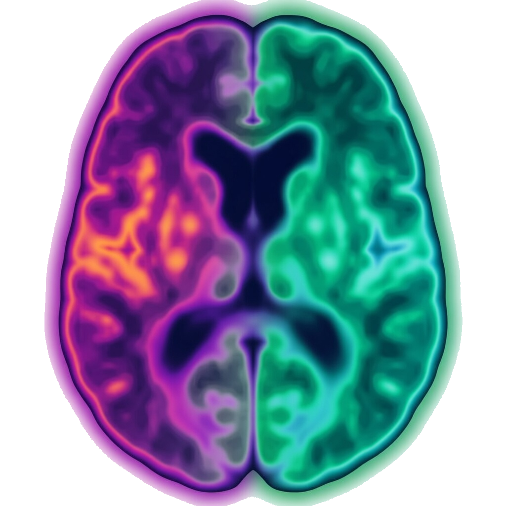

# ZVA-0102 — NuClide Brain

[Visual archive index](../../README.md) · [Full catalog](../README.md) · [Category: Identity, emblems, and interface icons](../categories/branding.md)

## What this image shows

The NuClide Research dual-brain co-brand, balancing Zoe and Nick through stable/unstable perspectives and correction. It is a user-supplied identity image, not an anatomical diagram.

## Role in Zoe

This visual supports recognition, navigation, application identity, or a cohesive visual language across Zoe and its components.

## Provenance and evidence boundary

**Provenance:** User-supplied NuClide Research co-brand.

The dual-brain mark is an identity image, not an anatomical or scientific model.

## File identity

- Archive ID: **ZVA-0102**
- Visual family: **nuclide-brain**
- Dimensions/format: **1024×1024 PNG**
- Frames: **1**
- Bytes: **967,482**
- SHA-256: `af5a2772375000517e69393dbb1b9e5c9a6515c5c89a68e880767aa975f4ca96`
- Original file: [Open full resolution](../../images/ZVA-0102.png)

## Source occurrences

Byte-identical copies are archived once while every known source path remains recorded.

| Source repository/collection | Original path | Canonical link |
|---|---|---|
| zoe | `assets/branding/nuclide-brain.png` | [Source](https://github.com/Ablation-Tool/zoe/blob/main/assets/branding/nuclide-brain.png) |
| zoe | `guiai-lab/build/lib/guiai/icons/nuclide-brain.png` | [Source](https://github.com/Ablation-Tool/zoe/blob/main/guiai-lab/build/lib/guiai/icons/nuclide-brain.png) |
| zoe | `guiai-lab/docs/images/nuclide-brain.png` | [Source](https://github.com/Ablation-Tool/zoe/blob/main/guiai-lab/docs/images/nuclide-brain.png) |
| zoe | `guiai-lab/guiai/icons/nuclide-brain.png` | [Source](https://github.com/Ablation-Tool/zoe/blob/main/guiai-lab/guiai/icons/nuclide-brain.png) |
| zoe | `mobile/android/app/build/intermediates/packaged_res/debug/packageDebugResources/drawable/nuclide_brain.png` | [Source](https://github.com/Ablation-Tool/zoe/blob/main/mobile/android/app/build/intermediates/packaged_res/debug/packageDebugResources/drawable/nuclide_brain.png) |
| zoe | `mobile/android/app/build/intermediates/packaged_res/release/packageReleaseResources/drawable/nuclide_brain.png` | [Source](https://github.com/Ablation-Tool/zoe/blob/main/mobile/android/app/build/intermediates/packaged_res/release/packageReleaseResources/drawable/nuclide_brain.png) |
| zoe | `mobile/android/app/src/main/res/drawable/nuclide_brain.png` | [Source](https://github.com/Ablation-Tool/zoe/blob/main/mobile/android/app/src/main/res/drawable/nuclide_brain.png) |
| zoe | `mobile/apple/Zoe/Assets.xcassets/NuclideBrain.imageset/nuclide-brain.png` | [Source](https://github.com/Ablation-Tool/zoe/blob/main/mobile/apple/Zoe/Assets.xcassets/NuclideBrain.imageset/nuclide-brain.png) |

## Documented context

### Zoe Pentacube

Source document: `zoe:research/papers/zoe-research/docs/native/PENTACUBE.md`

NuClide Research co-brand

**Zoe Pentacube combines the twelve free pentominoes with a legal 5×5 cube-permutation model.** Six solved faces contain thirty pentomino home regions. Outer and inner quarter turns then scramble 150 stickers through exact, reversible permutations. This is a new turn-based puzzle and inspection tool, not a Tetris clone, an official Rubik product, an optimal cube solver, or an intelligence test.

### 16. Nuclide brain

Source document: `zoe:research/papers/galleries/zoe-research/README.md`

Complete Zoe research asset index: Nuclide brain

`assets/native/nuclide-brain.png`

### Zoe Pentacube

Source document: `zoe:guiai-lab/docs/PENTACUBE.md`

NuClide Research co-brand

**Zoe Pentacube combines the twelve free pentominoes with a legal 5×5 cube-permutation model.** Six solved faces contain thirty pentomino home regions. Outer and inner quarter turns then scramble 150 stickers through exact, reversible permutations. This is a new turn-based puzzle and inspection tool, not a Tetris clone, an official Rubik product, an optimal cube solver, or an intelligence test.
