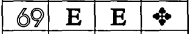

# ZVA-0104 — Symbol E

[Visual archive index](../../README.md) · [Full catalog](../README.md) · [Category: Source references and derivative reading copies](../categories/reference.md)

## What this image shows

A supplied E/e glyph-grid reference used to guide outlined GEM cells, not a new statement of GEM semantics. This asset preserves source context or a derivative reading view so that generated interpretations remain distinguishable from their references.

## Role in Zoe

This asset preserves source context or a derivative reading view so that generated interpretations remain distinguishable from their references.

## Provenance and evidence boundary

**Provenance:** User-supplied visual reference.

This is a supplied glyph/reference screenshot, not a Zoe-created scientific diagram.

## File identity

- Archive ID: **ZVA-0104**
- Visual family: **symbol-e**
- Dimensions/format: **313×57 PNG**
- Frames: **1**
- Bytes: **4,430**
- SHA-256: `5b4db025f265edca7e9afda730b0fb9f77d3e5f4464c5c38a8ba4c505c8c8021`
- Original file: [Open full resolution](../../images/ZVA-0104.png)

## Source occurrences

Byte-identical copies are archived once while every known source path remains recorded.

| Source repository/collection | Original path | Canonical link |
|---|---|---|
| zoe | `assets/branding/references/symbol-e.png` | [Source](https://github.com/Ablation-Tool/zoe/blob/main/assets/branding/references/symbol-e.png) |
