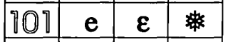

# ZVA-0105 — Symbol Epsilon

[Visual archive index](../../README.md) · [Full catalog](../README.md) · [Category: Source references and derivative reading copies](../categories/reference.md)

## What this image shows

A supplied epsilon/symbol-grid reference retained for the outlined GEM visual study. This asset preserves source context or a derivative reading view so that generated interpretations remain distinguishable from their references.

## Role in Zoe

This asset preserves source context or a derivative reading view so that generated interpretations remain distinguishable from their references.

## Provenance and evidence boundary

**Provenance:** User-supplied visual reference.

This is a supplied glyph/reference screenshot, not a Zoe-created scientific diagram.

## File identity

- Archive ID: **ZVA-0105**
- Visual family: **symbol-epsilon**
- Dimensions/format: **320×59 PNG**
- Frames: **1**
- Bytes: **3,975**
- SHA-256: `334f9dce8749bcb3806515cf167d81339376818a004b6b5c769b23b57bf11afc`
- Original file: [Open full resolution](../../images/ZVA-0105.png)

## Source occurrences

Byte-identical copies are archived once while every known source path remains recorded.

| Source repository/collection | Original path | Canonical link |
|---|---|---|
| zoe | `assets/branding/references/symbol-epsilon.png` | [Source](https://github.com/Ablation-Tool/zoe/blob/main/assets/branding/references/symbol-epsilon.png) |
