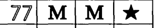

# ZVA-0107 — Symbol M

[Visual archive index](../../README.md) · [Full catalog](../README.md) · [Category: Source references and derivative reading copies](../categories/reference.md)

## What this image shows

A supplied M/m glyph-grid reference used in the original GEM scene composition. This asset preserves source context or a derivative reading view so that generated interpretations remain distinguishable from their references.

## Role in Zoe

This asset preserves source context or a derivative reading view so that generated interpretations remain distinguishable from their references.

## Provenance and evidence boundary

**Provenance:** User-supplied visual reference.

This is a supplied glyph/reference screenshot, not a Zoe-created scientific diagram.

## File identity

- Archive ID: **ZVA-0107**
- Visual family: **symbol-m**
- Dimensions/format: **313×57 PNG**
- Frames: **1**
- Bytes: **3,930**
- SHA-256: `86fd3e8e3fd181e4a3694b00702fc23b6031cd7ce9bd8c410d4837423a98b29e`
- Original file: [Open full resolution](../../images/ZVA-0107.png)

## Source occurrences

Byte-identical copies are archived once while every known source path remains recorded.

| Source repository/collection | Original path | Canonical link |
|---|---|---|
| zoe | `assets/branding/references/symbol-m.png` | [Source](https://github.com/Ablation-Tool/zoe/blob/main/assets/branding/references/symbol-m.png) |
