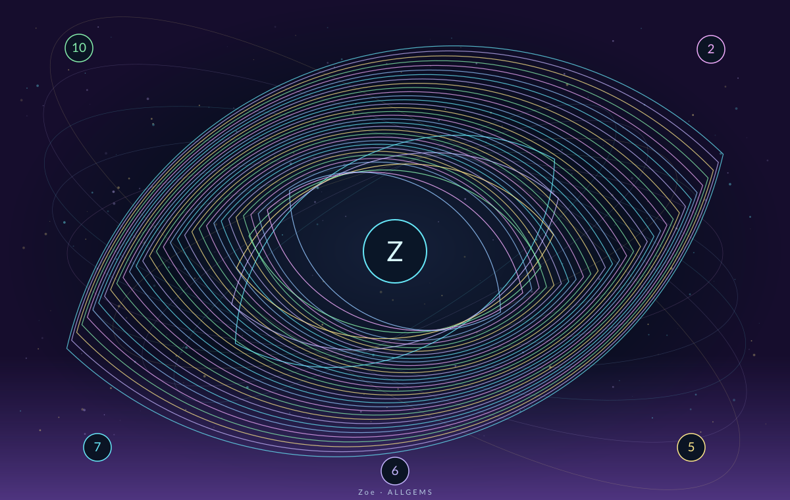

# ZVA-0113 — Zoe Orbital Eye Legacy

[Visual archive index](../../README.md) · [Full catalog](../README.md) · [Category: Identity, emblems, and interface icons](../categories/branding.md)

## What this image shows

The former Zoe orbital emblem: a central Z, nested eye curves, stars, and numbered nodes preserved as historical identity artwork. This visual supports recognition, navigation, application identity, or a cohesive visual language across Zoe and its components.

## Role in Zoe

This visual supports recognition, navigation, application identity, or a cohesive visual language across Zoe and its components.

## Provenance and evidence boundary

**Provenance:** Project identity or interface asset.

Functional and identity artwork does not constitute research evidence.

## File identity

- Archive ID: **ZVA-0113**
- Visual family: **zoe-orbital-eye-legacy**
- Dimensions/format: **SVG 1200×760**
- Frames: **vector/not applicable**
- Bytes: **30,687**
- SHA-256: `aeeeeaad0deacf79c3fe0518d229c6533b42a8116012425c26d0e799d7ce4c82`
- Original file: [Open full resolution](../../images/ZVA-0113.svg)

## Source occurrences

Byte-identical copies are archived once while every known source path remains recorded.

| Source repository/collection | Original path | Canonical link |
|---|---|---|
| zoe | `assets/branding/zoe-orbital-eye-legacy.svg` | [Source](https://github.com/Ablation-Tool/zoe/blob/main/assets/branding/zoe-orbital-eye-legacy.svg) |

## Related format/size variants

- [ZVA-0112](ZVA-0112.md)
