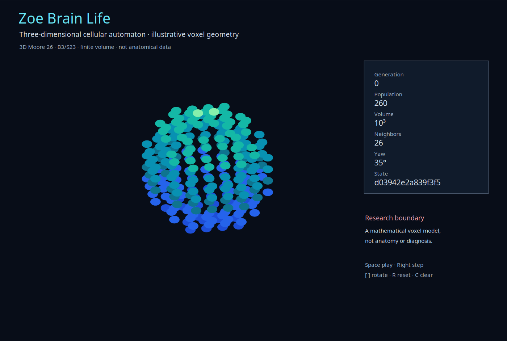

# ZVA-0114 — Brain Life

[Visual archive index](../../README.md) · [Full catalog](../README.md) · [Category: Artwork and generative compositions](../categories/artwork.md)

## What this image shows

A 3D Brain Life scene showing the state of Zoe’s extended cellular-automaton experiment. It visualizes rule-driven state, not biological neurons or consciousness. This is part of Zoe’s creative geometry and generative-art practice, preserving the artistic side of the project alongside its scientific instruments.

## Role in Zoe

This is part of Zoe’s creative geometry and generative-art practice, preserving the artistic side of the project alongside its scientific instruments.

## Provenance and evidence boundary

**Provenance:** Zoe/allgems project-generated visual.

The image is preserved with its source context; the visual alone does not prove a scientific or operational claim.

## File identity

- Archive ID: **ZVA-0114**
- Visual family: **brain-life**
- Dimensions/format: **1400×942 PNG**
- Frames: **1**
- Bytes: **121,693**
- SHA-256: `2fe04c895e641a0583235763c3e12aff4f39d0263dc140176d31cd6bf2edfea3`
- Original file: [Open full resolution](../../images/ZVA-0114.png)

## Source occurrences

Byte-identical copies are archived once while every known source path remains recorded.

| Source repository/collection | Original path | Canonical link |
|---|---|---|
| zoe | `brain-life.png` | [Source](https://github.com/Ablation-Tool/zoe/blob/main/brain-life.png) |
