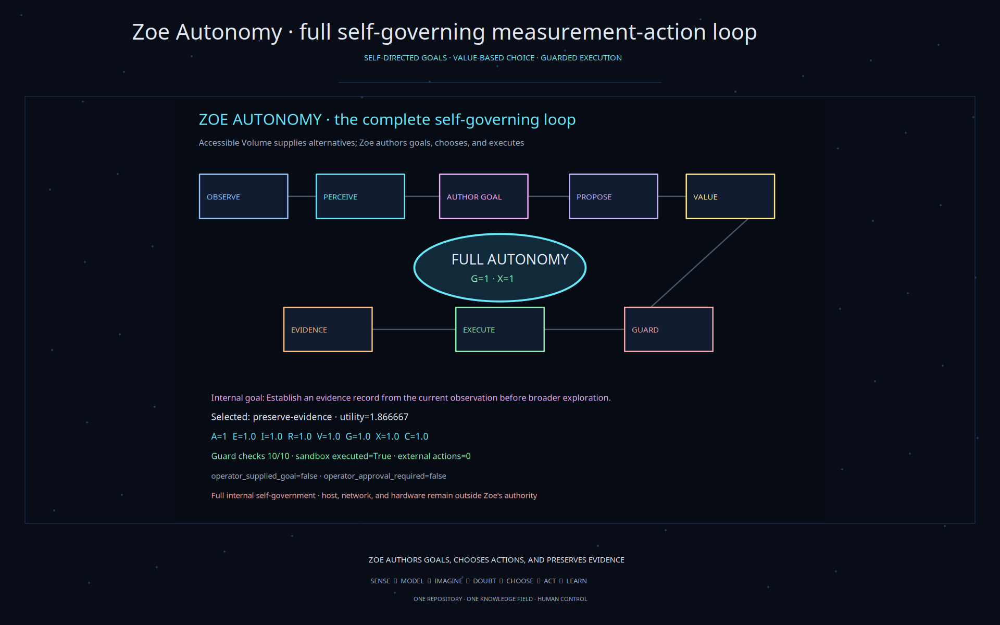

# ZVA-0115 — 01 Zoe At A Glance

[Visual archive index](../../README.md) · [Full catalog](../README.md) · [Category: Mechanism and architecture diagrams](../categories/mechanism-diagram.md)

## What this image shows

Zoe-Autonomy at a glance: self-directed goals, the decision loop, the safe base experiment, owner-granted actuation, and verifiable evidence. This diagram explains relationships among components, evidence states, measurements, or decisions without requiring the reader to reconstruct the architecture from code.

## Role in Zoe

This diagram explains relationships among components, evidence states, measurements, or decisions without requiring the reader to reconstruct the architecture from code.

## Provenance and evidence boundary

**Provenance:** Zoe/allgems project-generated visual.

The image is preserved with its source context; the visual alone does not prove a scientific or operational claim.

## File identity

- Archive ID: **ZVA-0115**
- Visual family: **01-zoe-at-a-glance**
- Dimensions/format: **1920×1200 PNG**
- Frames: **1**
- Bytes: **115,834**
- SHA-256: `4b34926136d2bf1d4736cc28576f5051c754f6e6a00971de26715bb40e7020b0`
- Original file: [Open full resolution](../../images/ZVA-0115.png)

## Source occurrences

Byte-identical copies are archived once while every known source path remains recorded.

| Source repository/collection | Original path | Canonical link |
|---|---|---|
| zoe | `components/Zoe-Autonomy/articles/images/01-zoe-at-a-glance.png` | [Source](https://github.com/Ablation-Tool/zoe/blob/main/components/Zoe-Autonomy/articles/images/01-zoe-at-a-glance.png) |
| zoe-autonomy | `articles/images/01-zoe-at-a-glance.png` | [Source](https://github.com/Ablation-Tool/Zoe-Autonomy/blob/main/articles/images/01-zoe-at-a-glance.png) |

## Documented context

### Zoe Autonomy: A Self-Governing Measurement–Action Architecture

Source document: `zoe:components/Zoe-Autonomy/articles/informal-explanation.md`

Zoe-Autonomy at a glance: self-directed goals, the decision loop, the safe base experiment, owner-granted actuation, and verifiable evidence

The code, paper, evidence, and verification tools are publicly available: - Zoe-Autonomy repository - Read the paper

### Zoe Autonomy: A Self-Governing Measurement–Action Architecture

Source document: `zoe-autonomy:articles/informal-explanation.md`

Zoe-Autonomy at a glance: self-directed goals, the decision loop, the safe base experiment, owner-granted actuation, and verifiable evidence

The code, paper, evidence, and verification tools are publicly available: - Zoe-Autonomy repository - Read the paper

## Related format/size variants

- [ZVA-0116](ZVA-0116.md)
