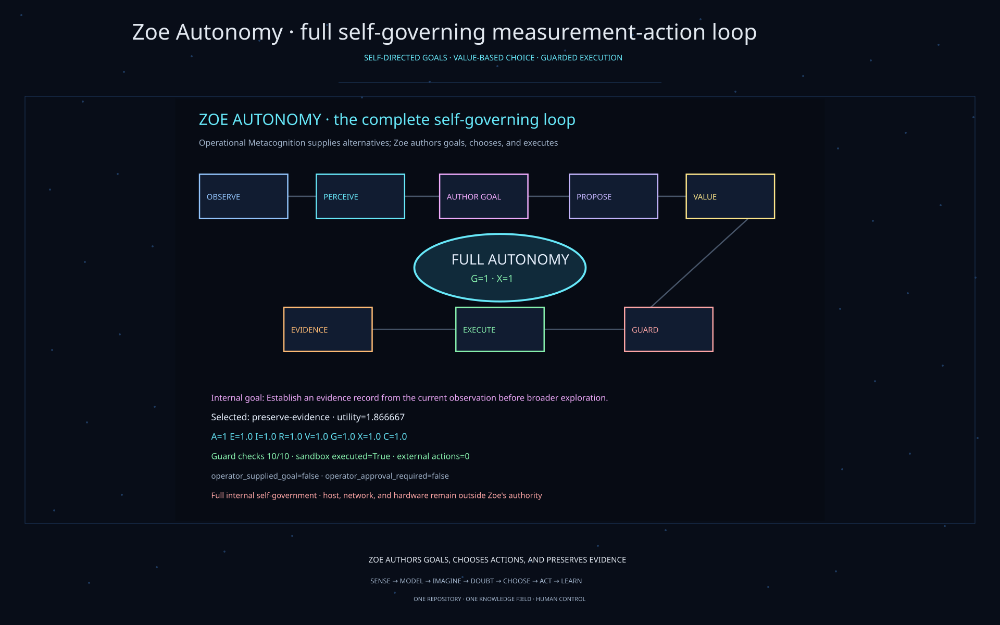

# ZVA-0116 — 01 Zoe At A Glance

[Visual archive index](../../README.md) · [Full catalog](../README.md) · [Category: Mechanism and architecture diagrams](../categories/mechanism-diagram.md)

## What this image shows

01 Zoe At A Glance is a mechanism and architecture diagrams asset from the Zoe-Autonomy portion of the Zoe/allgems project. This diagram explains relationships among components, evidence states, measurements, or decisions without requiring the reader to reconstruct the architecture from code.

## Role in Zoe

This diagram explains relationships among components, evidence states, measurements, or decisions without requiring the reader to reconstruct the architecture from code.

## Provenance and evidence boundary

**Provenance:** Zoe/allgems project-generated visual.

The image is preserved with its source context; the visual alone does not prove a scientific or operational claim.

## File identity

- Archive ID: **ZVA-0116**
- Visual family: **01-zoe-at-a-glance**
- Dimensions/format: **SVG 1920×1200**
- Frames: **vector/not applicable**
- Bytes: **28,209**
- SHA-256: `f040f8a13087cc7e63557f169ec116ab223cdbfbade163f0f20a72adb4039d6c`
- Original file: [Open full resolution](../../images/ZVA-0116.svg)

## Source occurrences

Byte-identical copies are archived once while every known source path remains recorded.

| Source repository/collection | Original path | Canonical link |
|---|---|---|
| zoe | `components/Zoe-Autonomy/articles/images/01-zoe-at-a-glance.svg` | [Source](https://github.com/Ablation-Tool/zoe/blob/main/components/Zoe-Autonomy/articles/images/01-zoe-at-a-glance.svg) |
| zoe-autonomy | `articles/images/01-zoe-at-a-glance.svg` | [Source](https://github.com/Ablation-Tool/Zoe-Autonomy/blob/main/articles/images/01-zoe-at-a-glance.svg) |

## Related format/size variants

- [ZVA-0115](ZVA-0115.md)
