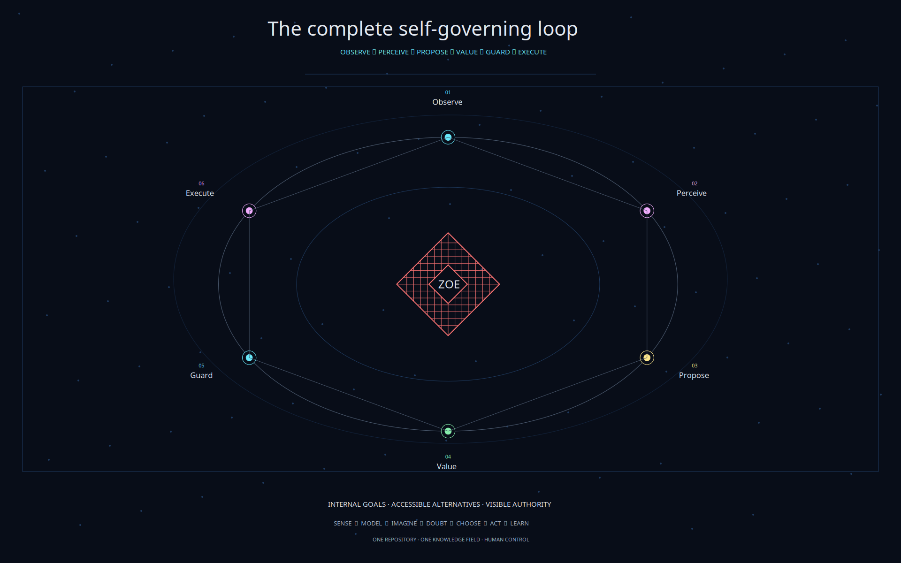

# ZVA-0117 — 02 Self Governing Loop

[Visual archive index](../../README.md) · [Full catalog](../README.md) · [Category: Mechanism and architecture diagrams](../categories/mechanism-diagram.md)

<a href="../../images/ZVA-0117.png"></a>

## What this image shows

The complete self-governing loop and the distinction between the zero-external-action base experiment and owner-granted actuation. This diagram explains relationships among components, evidence states, measurements, or decisions without requiring the reader to reconstruct the architecture from code.

## Role in Zoe

This diagram explains relationships among components, evidence states, measurements, or decisions without requiring the reader to reconstruct the architecture from code.

## Provenance and evidence boundary

**Provenance:** Zoe/allgems project-generated visual.

The image is preserved with its source context; the visual alone does not prove a scientific or operational claim.

## File identity

- Archive ID: **ZVA-0117**
- Visual family: **02-self-governing-loop**
- Dimensions/format: **1920×1200 PNG**
- Frames: **1**
- Bytes: **130,160**
- SHA-256: `c1a6781086c1c2972e2d939137d098ff2a55eb0d94ee38adbef3a351c04be8c3`
- Original file: [Open full resolution](../../images/ZVA-0117.png)

## Source occurrences

Byte-identical copies are archived once while every known source path remains recorded.

| Source repository/collection | Original path | Canonical link |
|---|---|---|
| zoe | `components/Zoe-Autonomy/articles/images/02-self-governing-loop.png` | [Source](https://github.com/Ablation-Tool/zoe/blob/main/components/Zoe-Autonomy/articles/images/02-self-governing-loop.png) |
| zoe-autonomy | `articles/images/02-self-governing-loop.png` | [Source](https://github.com/Ablation-Tool/Zoe-Autonomy/blob/main/articles/images/02-self-governing-loop.png) |


## Documented context

### From measurement to self-government

Source document: `zoe:components/Zoe-Autonomy/articles/informal-explanation.md`

The complete self-governing loop and the distinction between the zero-external-action base experiment and owner-granted actuation

∘ Proposeπ ∘ Perceiveτ,δ ∘ M(Sₜ,Cₜ) ```

### From measurement to self-government

Source document: `zoe-autonomy:articles/informal-explanation.md`

The complete self-governing loop and the distinction between the zero-external-action base experiment and owner-granted actuation

∘ Proposeπ ∘ Perceiveτ,δ ∘ M(Sₜ,Cₜ) ```

## Related format/size variants

- [ZVA-0118](ZVA-0118.md)
