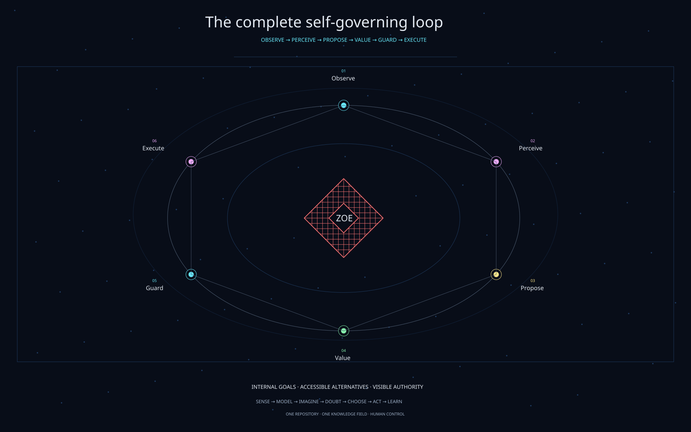

# ZVA-0118 — 02 Self Governing Loop

[Visual archive index](../../README.md) · [Full catalog](../README.md) · [Category: Mechanism and architecture diagrams](../categories/mechanism-diagram.md)

## What this image shows

02 Self Governing Loop is a mechanism and architecture diagrams asset from the Zoe-Autonomy portion of the Zoe/allgems project. This diagram explains relationships among components, evidence states, measurements, or decisions without requiring the reader to reconstruct the architecture from code.

## Role in Zoe

This diagram explains relationships among components, evidence states, measurements, or decisions without requiring the reader to reconstruct the architecture from code.

## Provenance and evidence boundary

**Provenance:** Zoe/allgems project-generated visual.

The image is preserved with its source context; the visual alone does not prove a scientific or operational claim.

## File identity

- Archive ID: **ZVA-0118**
- Visual family: **02-self-governing-loop**
- Dimensions/format: **SVG 1920×1200**
- Frames: **vector/not applicable**
- Bytes: **34,751**
- SHA-256: `bf9481ccd0c7f792b43ce7cd2f6fd0b5b7fc67acfcd3cb4d41e112014093010b`
- Original file: [Open full resolution](../../images/ZVA-0118.svg)

## Source occurrences

Byte-identical copies are archived once while every known source path remains recorded.

| Source repository/collection | Original path | Canonical link |
|---|---|---|
| zoe | `components/Zoe-Autonomy/articles/images/02-self-governing-loop.svg` | [Source](https://github.com/Ablation-Tool/zoe/blob/main/components/Zoe-Autonomy/articles/images/02-self-governing-loop.svg) |
| zoe-autonomy | `articles/images/02-self-governing-loop.svg` | [Source](https://github.com/Ablation-Tool/Zoe-Autonomy/blob/main/articles/images/02-self-governing-loop.svg) |

## Related format/size variants

- [ZVA-0117](ZVA-0117.md)
