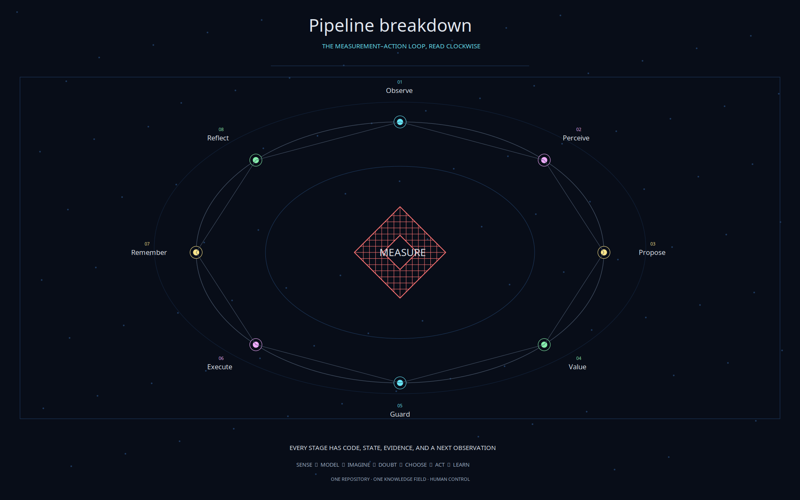

# ZVA-0119 — 03 Pipeline Breakdown

[Visual archive index](../../README.md) · [Full catalog](../README.md) · [Category: Mechanism and architecture diagrams](../categories/mechanism-diagram.md)

## What this image shows

Pipeline breakdown for Memory and State, Perception, Proposal, Valuation, Guarding, and Execution. This diagram explains relationships among components, evidence states, measurements, or decisions without requiring the reader to reconstruct the architecture from code.

## Role in Zoe

This diagram explains relationships among components, evidence states, measurements, or decisions without requiring the reader to reconstruct the architecture from code.

## Provenance and evidence boundary

**Provenance:** Zoe/allgems project-generated visual.

The image is preserved with its source context; the visual alone does not prove a scientific or operational claim.

## File identity

- Archive ID: **ZVA-0119**
- Visual family: **03-pipeline-breakdown**
- Dimensions/format: **1920×1200 PNG**
- Frames: **1**
- Bytes: **144,546**
- SHA-256: `5e0a49be09c48b3469737cf33a2a25b66d978be9d06462eb15848e015814bcd4`
- Original file: [Open full resolution](../../images/ZVA-0119.png)

## Source occurrences

Byte-identical copies are archived once while every known source path remains recorded.

| Source repository/collection | Original path | Canonical link |
|---|---|---|
| zoe | `components/Zoe-Autonomy/articles/images/03-pipeline-breakdown.png` | [Source](https://github.com/Ablation-Tool/zoe/blob/main/components/Zoe-Autonomy/articles/images/03-pipeline-breakdown.png) |
| zoe-autonomy | `articles/images/03-pipeline-breakdown.png` | [Source](https://github.com/Ablation-Tool/Zoe-Autonomy/blob/main/articles/images/03-pipeline-breakdown.png) |

## Documented context

### From measurement to self-government

Source document: `zoe:components/Zoe-Autonomy/articles/informal-explanation.md`

Pipeline breakdown for Memory and State, Perception, Proposal, Valuation, Guarding, and Execution

- **Presence** maintains an explicit self-model and its uncertainties. - **Evidence chains** preserve the resulting measurements, decisions, and state transitions. The autonomy claim belongs to this combination—not to Operational Metacognition alone.

### From measurement to self-government

Source document: `zoe-autonomy:articles/informal-explanation.md`

Pipeline breakdown for Memory and State, Perception, Proposal, Valuation, Guarding, and Execution

- **Presence** maintains an explicit self-model and its uncertainties. - **Evidence chains** preserve the resulting measurements, decisions, and state transitions. The autonomy claim belongs to this combination—not to Operational Metacognition alone.

## Related format/size variants

- [ZVA-0120](ZVA-0120.md)
