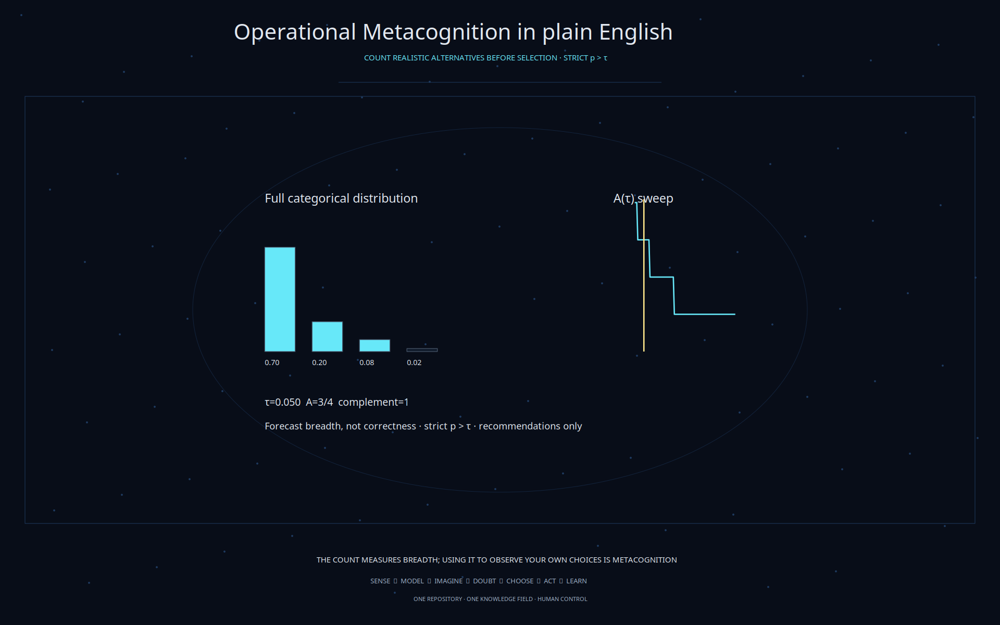

# ZVA-0121 — 04 Accessible Volume

[Visual archive index](../../README.md) · [Full catalog](../README.md) · [Category: Research figures and measurements](../categories/research-figure.md)

<a href="../../images/ZVA-0121.png"></a>

## What this image shows

Operational Metacognition in plain English, including the equation, variable definitions, and a worked threshold example. This figure preserves a measurement, model output, simulation, geometric construction, or research explanation from the Zoe/allgems program.

## Role in Zoe

This figure preserves a measurement, model output, simulation, geometric construction, or research explanation from the Zoe/allgems program.

## Provenance and evidence boundary

**Provenance:** Zoe/allgems project-generated visual.

The image is preserved with its source context; the visual alone does not prove a scientific or operational claim.

## File identity

- Archive ID: **ZVA-0121**
- Visual family: **04-accessible-volume**
- Dimensions/format: **1920×1200 PNG**
- Frames: **1**
- Bytes: **86,152**
- SHA-256: `eee9296ec1e6198f0896f58923429584a26652b4d4f0f17d53f7ea38965531c0`
- Original file: [Open full resolution](../../images/ZVA-0121.png)

## Source occurrences

Byte-identical copies are archived once while every known source path remains recorded.

| Source repository/collection | Original path | Canonical link |
|---|---|---|
| zoe | `components/Zoe-Autonomy/articles/images/04-accessible-volume.png` | [Source](https://github.com/Ablation-Tool/zoe/blob/main/components/Zoe-Autonomy/articles/images/04-accessible-volume.png) |
| zoe-autonomy | `articles/images/04-accessible-volume.png` | [Source](https://github.com/Ablation-Tool/Zoe-Autonomy/blob/main/articles/images/04-accessible-volume.png) |


## Documented context

### Starting with the alternatives behind an output

Source document: `zoe:components/Zoe-Autonomy/articles/informal-explanation.md`

Operational Metacognition in plain English, including the equation, variable definitions, and a worked threshold example

```text A0.05(S) = 3 ```

### Starting with the alternatives behind an output

Source document: `zoe-autonomy:articles/informal-explanation.md`

Operational Metacognition in plain English, including the equation, variable definitions, and a worked threshold example

```text A0.05(S) = 3 ```

## Related format/size variants

- [ZVA-0122](ZVA-0122.md)
