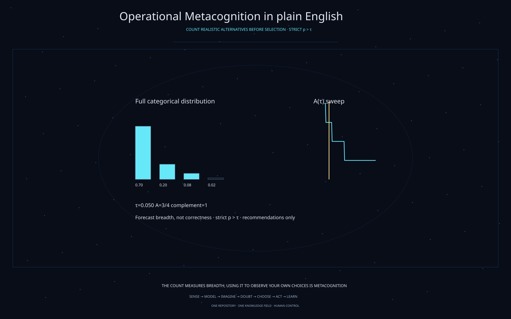

# ZVA-0122 — 04 Accessible Volume

[Visual archive index](../../README.md) · [Full catalog](../README.md) · [Category: Research figures and measurements](../categories/research-figure.md)

## What this image shows

04 Accessible Volume is a research figures and measurements asset from the Zoe-Autonomy portion of the Zoe/allgems project. This figure preserves a measurement, model output, simulation, geometric construction, or research explanation from the Zoe/allgems program.

## Role in Zoe

This figure preserves a measurement, model output, simulation, geometric construction, or research explanation from the Zoe/allgems program.

## Provenance and evidence boundary

**Provenance:** Zoe/allgems project-generated visual.

The image is preserved with its source context; the visual alone does not prove a scientific or operational claim.

## File identity

- Archive ID: **ZVA-0122**
- Visual family: **04-accessible-volume**
- Dimensions/format: **SVG 1920×1200**
- Frames: **vector/not applicable**
- Bytes: **24,372**
- SHA-256: `d2e4d7737b69548a14c51fa5153a8cf87d95014f5016ea36a310efb0fa50d521`
- Original file: [Open full resolution](../../images/ZVA-0122.svg)

## Source occurrences

Byte-identical copies are archived once while every known source path remains recorded.

| Source repository/collection | Original path | Canonical link |
|---|---|---|
| zoe | `components/Zoe-Autonomy/articles/images/04-accessible-volume.svg` | [Source](https://github.com/Ablation-Tool/zoe/blob/main/components/Zoe-Autonomy/articles/images/04-accessible-volume.svg) |
| zoe-autonomy | `articles/images/04-accessible-volume.svg` | [Source](https://github.com/Ablation-Tool/Zoe-Autonomy/blob/main/articles/images/04-accessible-volume.svg) |

## Related format/size variants

- [ZVA-0121](ZVA-0121.md)
