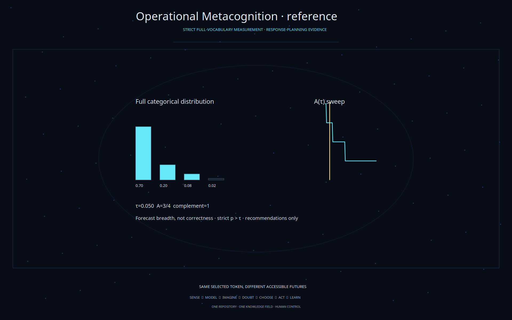

# ZVA-0124 — 05 Accessible Volume Reference

[Visual archive index](../../README.md) · [Full catalog](../README.md) · [Category: Research figures and measurements](../categories/research-figure.md)

## What this image shows

05 Accessible Volume Reference is a research figures and measurements asset from the Zoe-Autonomy portion of the Zoe/allgems project. This figure preserves a measurement, model output, simulation, geometric construction, or research explanation from the Zoe/allgems program.

## Role in Zoe

This figure preserves a measurement, model output, simulation, geometric construction, or research explanation from the Zoe/allgems program.

## Provenance and evidence boundary

**Provenance:** Zoe/allgems project-generated visual.

The image is preserved with its source context; the visual alone does not prove a scientific or operational claim.

## File identity

- Archive ID: **ZVA-0124**
- Visual family: **05-accessible-volume-reference**
- Dimensions/format: **1920×1200 PNG**
- Frames: **1**
- Bytes: **84,613**
- SHA-256: `6141db9f9149c9cbb4b1dd1678f728e43fbc85c8a0c79208003a354b5118f8c0`
- Original file: [Open full resolution](../../images/ZVA-0124.png)

## Source occurrences

Byte-identical copies are archived once while every known source path remains recorded.

| Source repository/collection | Original path | Canonical link |
|---|---|---|
| zoe | `components/Zoe-Autonomy/articles/images/05-accessible-volume-reference.png` | [Source](https://github.com/Ablation-Tool/zoe/blob/main/components/Zoe-Autonomy/articles/images/05-accessible-volume-reference.png) |
| zoe-autonomy | `articles/images/05-accessible-volume-reference.png` | [Source](https://github.com/Ablation-Tool/Zoe-Autonomy/blob/main/articles/images/05-accessible-volume-reference.png) |

## Related format/size variants

- [ZVA-0123](ZVA-0123.md)
- [ZVA-0125](ZVA-0125.md)
