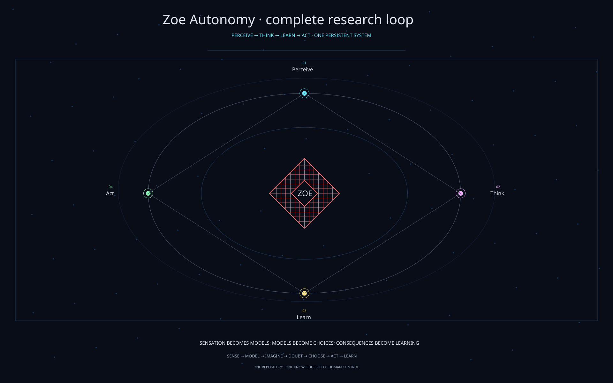

# ZVA-0127 — 06 Pipeline Reference

[Visual archive index](../../README.md) · [Full catalog](../README.md) · [Category: Mechanism and architecture diagrams](../categories/mechanism-diagram.md)

## What this image shows

06 Pipeline Reference is a mechanism and architecture diagrams asset from the Zoe-Autonomy portion of the Zoe/allgems project. This diagram explains relationships among components, evidence states, measurements, or decisions without requiring the reader to reconstruct the architecture from code.

## Role in Zoe

This diagram explains relationships among components, evidence states, measurements, or decisions without requiring the reader to reconstruct the architecture from code.

## Provenance and evidence boundary

**Provenance:** Zoe/allgems project-generated visual.

The image is preserved with its source context; the visual alone does not prove a scientific or operational claim.

## File identity

- Archive ID: **ZVA-0127**
- Visual family: **06-pipeline-reference**
- Dimensions/format: **SVG 1920×1200**
- Frames: **vector/not applicable**
- Bytes: **32,428**
- SHA-256: `c5f3403f1ad43d044def10b7bdf31120cfb7dccf564d8bd2b1ceeb2171e71bfc`
- Original file: [Open full resolution](../../images/ZVA-0127.svg)

## Source occurrences

Byte-identical copies are archived once while every known source path remains recorded.

| Source repository/collection | Original path | Canonical link |
|---|---|---|
| zoe | `components/Zoe-Autonomy/articles/images/06-pipeline-reference.svg` | [Source](https://github.com/Ablation-Tool/zoe/blob/main/components/Zoe-Autonomy/articles/images/06-pipeline-reference.svg) |
| zoe-autonomy | `articles/images/06-pipeline-reference.svg` | [Source](https://github.com/Ablation-Tool/Zoe-Autonomy/blob/main/articles/images/06-pipeline-reference.svg) |

## Related format/size variants

- [ZVA-0126](ZVA-0126.md)
