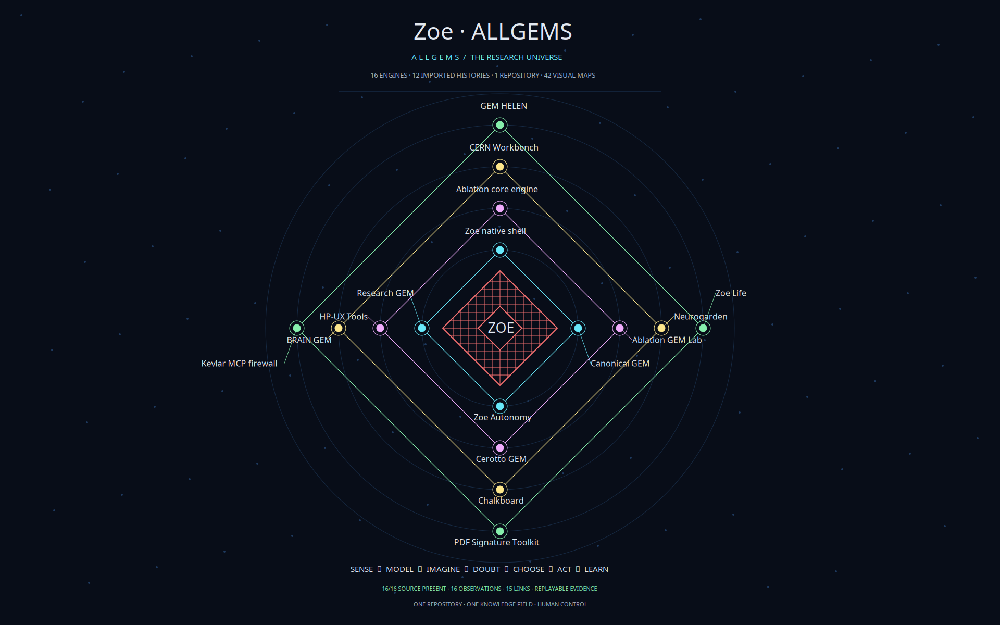

# ZVA-0128 — 07 Zoe Overview Reference

[Visual archive index](../../README.md) · [Full catalog](../README.md) · [Category: Research figures and measurements](../categories/research-figure.md)

## What this image shows

Original Zoe-Autonomy conceptual overview supplied for this guide. This figure preserves a measurement, model output, simulation, geometric construction, or research explanation from the Zoe/allgems program.

## Role in Zoe

This figure preserves a measurement, model output, simulation, geometric construction, or research explanation from the Zoe/allgems program.

## Provenance and evidence boundary

**Provenance:** Zoe/allgems project-generated visual.

The image is preserved with its source context; the visual alone does not prove a scientific or operational claim.

## File identity

- Archive ID: **ZVA-0128**
- Visual family: **07-zoe-overview-reference**
- Dimensions/format: **1920×1200 PNG**
- Frames: **1**
- Bytes: **189,473**
- SHA-256: `01c9642fd527fc45da49564b26825d2eb84f9244130ecd556bcccb4bcddfa17c`
- Original file: [Open full resolution](../../images/ZVA-0128.png)

## Source occurrences

Byte-identical copies are archived once while every known source path remains recorded.

| Source repository/collection | Original path | Canonical link |
|---|---|---|
| zoe | `components/Zoe-Autonomy/articles/images/07-zoe-overview-reference.png` | [Source](https://github.com/Ablation-Tool/zoe/blob/main/components/Zoe-Autonomy/articles/images/07-zoe-overview-reference.png) |
| zoe-autonomy | `articles/images/07-zoe-overview-reference.png` | [Source](https://github.com/Ablation-Tool/Zoe-Autonomy/blob/main/articles/images/07-zoe-overview-reference.png) |

## Documented context

### Zoe Autonomy: A Self-Governing Measurement–Action Architecture

Source document: `zoe:components/Zoe-Autonomy/articles/informal-explanation.md`

Original Zoe-Autonomy conceptual overview supplied for this guide

*The five central ideas behind the architecture.*

### Zoe Autonomy: A Self-Governing Measurement–Action Architecture

Source document: `zoe-autonomy:articles/informal-explanation.md`

Original Zoe-Autonomy conceptual overview supplied for this guide

*The five central ideas behind the architecture.*

## Related format/size variants

- [ZVA-0129](ZVA-0129.md)
