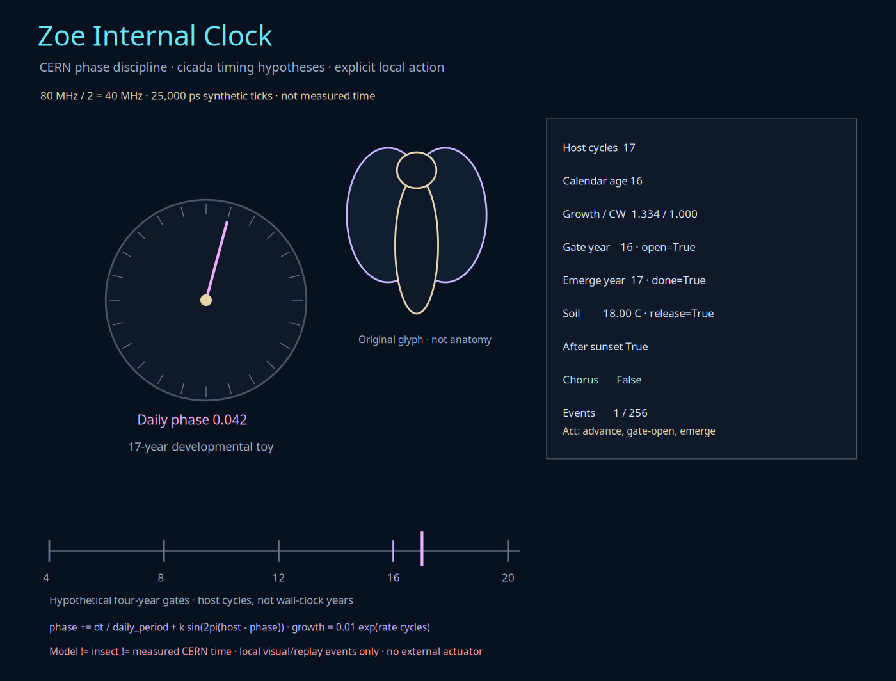

# ZVA-0132 — Cicada

[Visual archive index](../../README.md) · [Full catalog](../README.md) · [Category: Research figures and measurements](../categories/research-figure.md)

## What this image shows

Cicada is a research figures and measurements asset from the Zoe-Autonomy portion of the Zoe/allgems project. This figure preserves a measurement, model output, simulation, geometric construction, or research explanation from the Zoe/allgems program.

## Role in Zoe

This figure preserves a measurement, model output, simulation, geometric construction, or research explanation from the Zoe/allgems program.

## Provenance and evidence boundary

**Provenance:** Zoe/allgems project-generated visual.

The image is preserved with its source context; the visual alone does not prove a scientific or operational claim.

## File identity

- Archive ID: **ZVA-0132**
- Visual family: **cicada**
- Dimensions/format: **1400×1064 PNG**
- Frames: **1**
- Bytes: **118,562**
- SHA-256: `108bed312a37a2e05c7ddb375556d9b9bdbf69efd0604ea8b9d62e8b538a73bb`
- Original file: [Open full resolution](../../images/ZVA-0132.png)

## Source occurrences

Byte-identical copies are archived once while every known source path remains recorded.

| Source repository/collection | Original path | Canonical link |
|---|---|---|
| zoe | `components/Zoe-Autonomy/paper/unified/figures/cicada.png` | [Source](https://github.com/Ablation-Tool/zoe/blob/main/components/Zoe-Autonomy/paper/unified/figures/cicada.png) |
| zoe | `components/next-token-predictability/paper/unified/figures/cicada.png` | [Source](https://github.com/Ablation-Tool/zoe/blob/main/components/next-token-predictability/paper/unified/figures/cicada.png) |
| zoe-autonomy | `paper/unified/figures/cicada.png` | [Source](https://github.com/Ablation-Tool/Zoe-Autonomy/blob/main/paper/unified/figures/cicada.png) |
| next-token | `paper/unified/figures/cicada.png` | [Source](https://github.com/Ablation-Tool/next-token-predictability/blob/main/paper/unified/figures/cicada.png) |

## Related format/size variants

- [ZVA-0001](ZVA-0001.md)
- [ZVA-0002](ZVA-0002.md)
