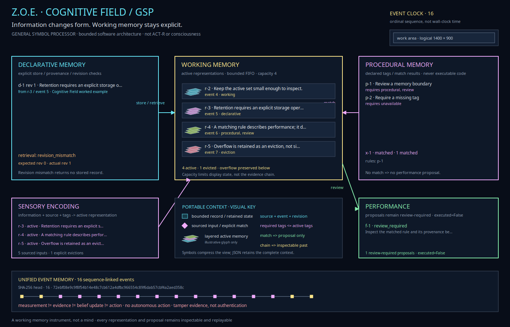

# ZVA-0133 — Cognitive Field

[Visual archive index](../../README.md) · [Full catalog](../README.md) · [Category: Research figures and measurements](../categories/research-figure.md)

## What this image shows

A Cognitive Field diagram showing sourced memory, revision checks, procedural matching, and explicit working-set boundaries. This figure preserves a measurement, model output, simulation, geometric construction, or research explanation from the Zoe/allgems program.

## Role in Zoe

This figure preserves a measurement, model output, simulation, geometric construction, or research explanation from the Zoe/allgems program.

## Provenance and evidence boundary

**Provenance:** Zoe/allgems project-generated visual.

The image is preserved with its source context; the visual alone does not prove a scientific or operational claim.

## File identity

- Archive ID: **ZVA-0133**
- Visual family: **cognitive-field**
- Dimensions/format: **1400×900 PNG**
- Frames: **1**
- Bytes: **146,212**
- SHA-256: `b2129c02a795069651c42660d2b8cf63969babab64aad69855f40008ce114b78`
- Original file: [Open full resolution](../../images/ZVA-0133.png)

## Source occurrences

Byte-identical copies are archived once while every known source path remains recorded.

| Source repository/collection | Original path | Canonical link |
|---|---|---|
| zoe | `components/Zoe-Autonomy/paper/unified/figures/cognitive-field.png` | [Source](https://github.com/Ablation-Tool/zoe/blob/main/components/Zoe-Autonomy/paper/unified/figures/cognitive-field.png) |
| zoe | `components/next-token-predictability/paper/unified/figures/cognitive-field.png` | [Source](https://github.com/Ablation-Tool/zoe/blob/main/components/next-token-predictability/paper/unified/figures/cognitive-field.png) |
| zoe-autonomy | `paper/unified/figures/cognitive-field.png` | [Source](https://github.com/Ablation-Tool/Zoe-Autonomy/blob/main/paper/unified/figures/cognitive-field.png) |
| next-token | `paper/unified/figures/cognitive-field.png` | [Source](https://github.com/Ablation-Tool/next-token-predictability/blob/main/paper/unified/figures/cognitive-field.png) |

## Related format/size variants

- [ZVA-0003](ZVA-0003.md)
- [ZVA-0004](ZVA-0004.md)
- [ZVA-0251](ZVA-0251.md)
- [ZVA-0252](ZVA-0252.md)
