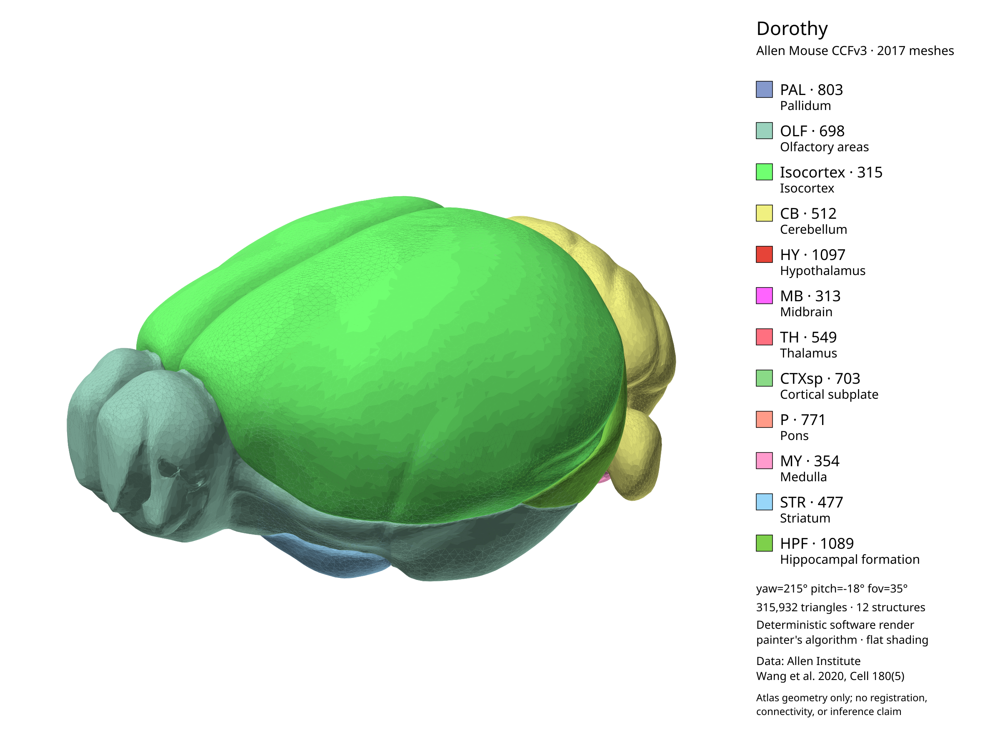

# ZVA-0134 — Dorothy CCFv3 2017

[Visual archive index](../../README.md) · [Full catalog](../README.md) · [Category: Research figures and measurements](../categories/research-figure.md)

## What this image shows

Dorothy’s deterministic twelve-structure Allen Mouse CCFv3 rendering, with structure labels, triangle count, camera state, and an explicit no-registration/no-connectivity boundary.

## Role in Zoe

This visual belongs to Dorothy’s inspectable spatial-research program, making reference geometry or a review instrument available for direct inspection.

## Provenance and evidence boundary

**Provenance:** Zoe render using Allen Institute reference data.

Preclinical mouse-atlas geometry only; not patient anatomy, registration, diagnosis, or treatment evidence.

## File identity

- Archive ID: **ZVA-0134**
- Visual family: **dorothy-ccf2017**
- Dimensions/format: **2400×1800 PNG**
- Frames: **1**
- Bytes: **1,313,483**
- SHA-256: `febc77d1ecda73dce62232be55f3b5a1256623da87d5378f781eb689fa5d3592`
- Original file: [Open full resolution](../../images/ZVA-0134.png)

## Source occurrences

Byte-identical copies are archived once while every known source path remains recorded.

| Source repository/collection | Original path | Canonical link |
|---|---|---|
| zoe | `components/Zoe-Autonomy/paper/unified/figures/dorothy-ccf2017.png` | [Source](https://github.com/Ablation-Tool/zoe/blob/main/components/Zoe-Autonomy/paper/unified/figures/dorothy-ccf2017.png) |
| zoe | `components/graphics-environment-manager/docs/images/dorothy-ccf2017.png` | [Source](https://github.com/Ablation-Tool/zoe/blob/main/components/graphics-environment-manager/docs/images/dorothy-ccf2017.png) |
| zoe | `components/next-token-predictability/paper/unified/figures/dorothy-ccf2017.png` | [Source](https://github.com/Ablation-Tool/zoe/blob/main/components/next-token-predictability/paper/unified/figures/dorothy-ccf2017.png) |
| zoe-autonomy | `paper/unified/figures/dorothy-ccf2017.png` | [Source](https://github.com/Ablation-Tool/Zoe-Autonomy/blob/main/paper/unified/figures/dorothy-ccf2017.png) |
| next-token | `paper/unified/figures/dorothy-ccf2017.png` | [Source](https://github.com/Ablation-Tool/next-token-predictability/blob/main/paper/unified/figures/dorothy-ccf2017.png) |
| paper-source-figures | `02-unified-autonomy/figures/dorothy-ccf2017.png` | [Source](https://github.com/Ablation-Tool/research-papers) |

## Documented context

### 1. Dorothy ccf2017

Source document: `zoe:research/papers/galleries/zoe-dorothy/README.md`

Dorothy and Neurogarden — Visual research index: Dorothy ccf2017

`assets/native/dorothy-ccf2017.png`

### 1. Dorothy ccf2017

Source document: `zoe:research/papers/galleries/zoe-research/README.md`

Complete Zoe research asset index: Dorothy ccf2017

`assets/dorothy/dorothy-ccf2017.png`

## Related format/size variants

- [ZVA-0330](ZVA-0330.md)
- [ZVA-0331](ZVA-0331.md)
