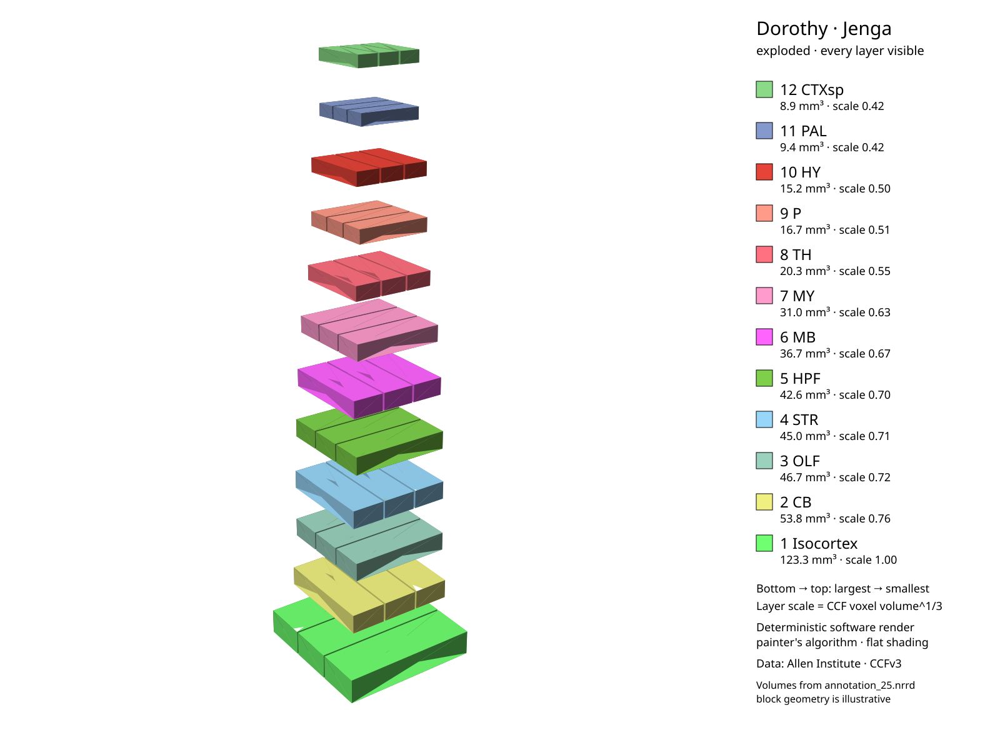

# ZVA-0135 — Dorothy Jenga Exploded

[Visual archive index](../../README.md) · [Full catalog](../README.md) · [Category: Research figures and measurements](../categories/research-figure.md)

## What this image shows

Dorothy Jenga’s volume-scaled exploded tower, offering spatial inspection of atlas structures without asserting anatomical relationships beyond the reference model. This visual belongs to Dorothy’s inspectable spatial-research program, making reference geometry or a review instrument available for direct inspection.

## Role in Zoe

This visual belongs to Dorothy’s inspectable spatial-research program, making reference geometry or a review instrument available for direct inspection.

## Provenance and evidence boundary

**Provenance:** Zoe render using Allen Institute reference data.

Preclinical mouse-atlas geometry only; not patient anatomy, registration, diagnosis, or treatment evidence.

## File identity

- Archive ID: **ZVA-0135**
- Visual family: **dorothy-jenga-exploded**
- Dimensions/format: **1600×1200 PNG**
- Frames: **1**
- Bytes: **214,145**
- SHA-256: `872190f58f484fce7c1127895be4531acf4c6b52e59a1a0952fd2001533fefdd`
- Original file: [Open full resolution](../../images/ZVA-0135.png)

## Source occurrences

Byte-identical copies are archived once while every known source path remains recorded.

| Source repository/collection | Original path | Canonical link |
|---|---|---|
| zoe | `components/Zoe-Autonomy/paper/unified/figures/dorothy-jenga-exploded.png` | [Source](https://github.com/Ablation-Tool/zoe/blob/main/components/Zoe-Autonomy/paper/unified/figures/dorothy-jenga-exploded.png) |
| zoe | `components/graphics-environment-manager/docs/images/dorothy-jenga-exploded.png` | [Source](https://github.com/Ablation-Tool/zoe/blob/main/components/graphics-environment-manager/docs/images/dorothy-jenga-exploded.png) |
| zoe | `components/next-token-predictability/paper/unified/figures/dorothy-jenga-exploded.png` | [Source](https://github.com/Ablation-Tool/zoe/blob/main/components/next-token-predictability/paper/unified/figures/dorothy-jenga-exploded.png) |
| zoe-autonomy | `paper/unified/figures/dorothy-jenga-exploded.png` | [Source](https://github.com/Ablation-Tool/Zoe-Autonomy/blob/main/paper/unified/figures/dorothy-jenga-exploded.png) |
| next-token | `paper/unified/figures/dorothy-jenga-exploded.png` | [Source](https://github.com/Ablation-Tool/next-token-predictability/blob/main/paper/unified/figures/dorothy-jenga-exploded.png) |
| paper-source-figures | `02-unified-autonomy/figures/dorothy-jenga-exploded.png` | [Source](https://github.com/Ablation-Tool/research-papers) |

## Documented context

### 3. Dorothy jenga exploded

Source document: `zoe:research/papers/galleries/zoe-dorothy/README.md`

Dorothy and Neurogarden — Visual research index: Dorothy jenga exploded

`assets/native/dorothy-jenga-exploded.png`

### 3. Dorothy jenga exploded

Source document: `zoe:research/papers/galleries/zoe-research/README.md`

Complete Zoe research asset index: Dorothy jenga exploded

`assets/dorothy/dorothy-jenga-exploded.png`

## Related format/size variants

- [ZVA-0332](ZVA-0332.md)
- [ZVA-0333](ZVA-0333.md)
