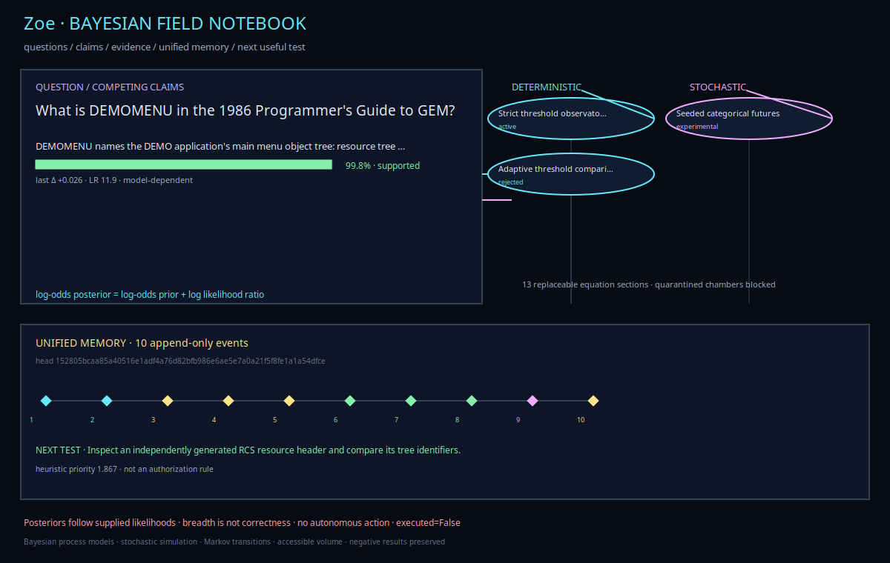

# ZVA-0138 — Field Notebook

[Visual archive index](../../README.md) · [Full catalog](../README.md) · [Category: Research figures and measurements](../categories/research-figure.md)

## What this image shows

Field Notebook is a research figures and measurements asset from the Zoe-Autonomy portion of the Zoe/allgems project. This figure preserves a measurement, model output, simulation, geometric construction, or research explanation from the Zoe/allgems program.

## Role in Zoe

This figure preserves a measurement, model output, simulation, geometric construction, or research explanation from the Zoe/allgems program.

## Provenance and evidence boundary

**Provenance:** Zoe/allgems project-generated visual.

The image is preserved with its source context; the visual alone does not prove a scientific or operational claim.

## File identity

- Archive ID: **ZVA-0138**
- Visual family: **field-notebook**
- Dimensions/format: **1200×760 PNG**
- Frames: **1**
- Bytes: **83,542**
- SHA-256: `75af3f71fbc4d4dc2da62b9d0508c8bcec3b08b3be25db47f1e28777a433a1a4`
- Original file: [Open full resolution](../../images/ZVA-0138.png)

## Source occurrences

Byte-identical copies are archived once while every known source path remains recorded.

| Source repository/collection | Original path | Canonical link |
|---|---|---|
| zoe | `components/Zoe-Autonomy/paper/unified/figures/field-notebook.png` | [Source](https://github.com/Ablation-Tool/zoe/blob/main/components/Zoe-Autonomy/paper/unified/figures/field-notebook.png) |
| zoe | `components/next-token-predictability/paper/unified/figures/field-notebook.png` | [Source](https://github.com/Ablation-Tool/zoe/blob/main/components/next-token-predictability/paper/unified/figures/field-notebook.png) |
| zoe-autonomy | `paper/unified/figures/field-notebook.png` | [Source](https://github.com/Ablation-Tool/Zoe-Autonomy/blob/main/paper/unified/figures/field-notebook.png) |
| next-token | `paper/unified/figures/field-notebook.png` | [Source](https://github.com/Ablation-Tool/next-token-predictability/blob/main/paper/unified/figures/field-notebook.png) |

## Related format/size variants

- [ZVA-0005](ZVA-0005.md)
- [ZVA-0006](ZVA-0006.md)
