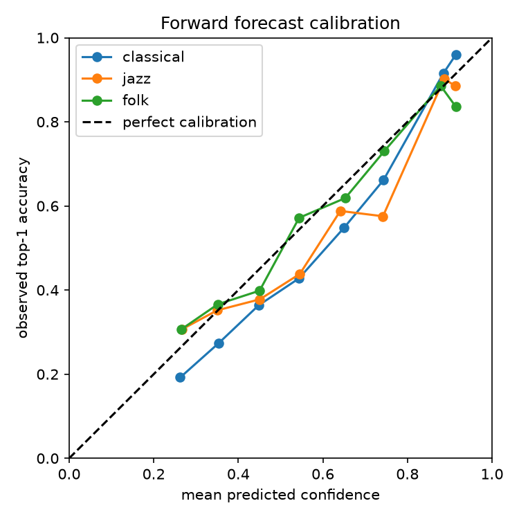

# ZVA-0145 — Nightingale Calibration

[Visual archive index](../../README.md) · [Full catalog](../README.md) · [Category: Research figures and measurements](../categories/research-figure.md)

## What this image shows

Forward forecast calibration. This figure preserves a measurement, model output, simulation, geometric construction, or research explanation from the Zoe/allgems program.

## Role in Zoe

This figure preserves a measurement, model output, simulation, geometric construction, or research explanation from the Zoe/allgems program.

## Provenance and evidence boundary

**Provenance:** Zoe/allgems project-generated visual.

The image is preserved with its source context; the visual alone does not prove a scientific or operational claim.

## File identity

- Archive ID: **ZVA-0145**
- Visual family: **nightingale-calibration**
- Dimensions/format: **750×750 PNG**
- Frames: **1**
- Bytes: **71,493**
- SHA-256: `696c2d52a9f8bb7242c58f919d8ec27155785a5ad2a2d5e34ec82ec335128821`
- Original file: [Open full resolution](../../images/ZVA-0145.png)

## Source occurrences

Byte-identical copies are archived once while every known source path remains recorded.

| Source repository/collection | Original path | Canonical link |
|---|---|---|
| zoe | `components/Zoe-Autonomy/paper/unified/figures/nightingale-calibration.png` | [Source](https://github.com/Ablation-Tool/zoe/blob/main/components/Zoe-Autonomy/paper/unified/figures/nightingale-calibration.png) |
| zoe | `components/next-token-predictability/evidence/rhythm-lab/real_midi_calibration.png` | [Source](https://github.com/Ablation-Tool/zoe/blob/main/components/next-token-predictability/evidence/rhythm-lab/real_midi_calibration.png) |
| zoe | `components/next-token-predictability/paper/unified/figures/nightingale-calibration.png` | [Source](https://github.com/Ablation-Tool/zoe/blob/main/components/next-token-predictability/paper/unified/figures/nightingale-calibration.png) |
| zoe-autonomy | `paper/unified/figures/nightingale-calibration.png` | [Source](https://github.com/Ablation-Tool/Zoe-Autonomy/blob/main/paper/unified/figures/nightingale-calibration.png) |
| next-token | `evidence/rhythm-lab/real_midi_calibration.png` | [Source](https://github.com/Ablation-Tool/next-token-predictability/blob/main/evidence/rhythm-lab/real_midi_calibration.png) |
| next-token | `paper/unified/figures/nightingale-calibration.png` | [Source](https://github.com/Ablation-Tool/next-token-predictability/blob/main/paper/unified/figures/nightingale-calibration.png) |
| paper-source-figures | `02-unified-autonomy/figures/nightingale-calibration.png` | [Source](https://github.com/Ablation-Tool/research-papers) |

## Documented context

### Evidence and reproducibility

Source document: `zoe:components/next-token-predictability/evidence/rhythm-lab/README.md`

Forward forecast calibration

- `analyze_ratings.py`: Spearman correlation analysis. - `../../scripts/real-midi-experiment.py`: complete experiment implementation.

### Evidence and reproducibility

Source document: `next-token:evidence/rhythm-lab/README.md`

Forward forecast calibration

- `analyze_ratings.py`: Spearman correlation analysis. - `../../scripts/real-midi-experiment.py`: complete experiment implementation.
