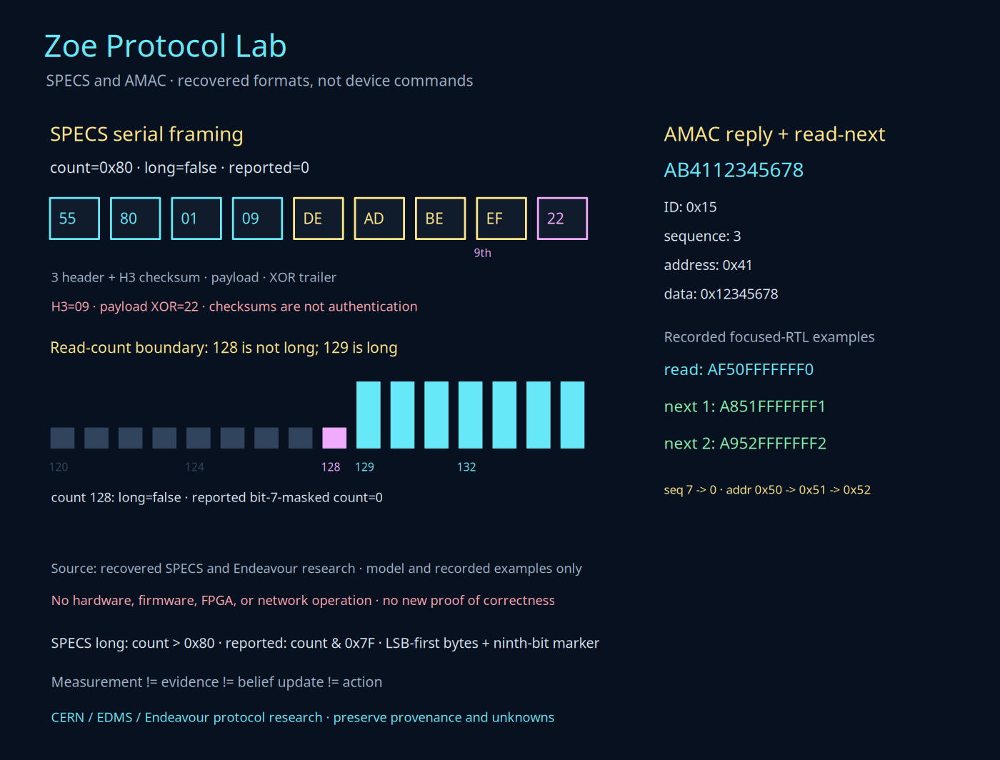

# ZVA-0149 — Protocol

[Visual archive index](../../README.md) · [Full catalog](../README.md) · [Category: Research figures and measurements](../categories/research-figure.md)

## What this image shows

Protocol is a research figures and measurements asset from the Zoe-Autonomy portion of the Zoe/allgems project. This visual belongs to Zoe’s CERN/source-evidence program, helping a reader inspect a corpus, protocol, replay, virtual system, or process boundary.

## Role in Zoe

This visual belongs to Zoe’s CERN/source-evidence program, helping a reader inspect a corpus, protocol, replay, virtual system, or process boundary.

## Provenance and evidence boundary

**Provenance:** Zoe/allgems project-generated visual.

The image is preserved with its source context; the visual alone does not prove a scientific or operational claim.

## File identity

- Archive ID: **ZVA-0149**
- Visual family: **protocol**
- Dimensions/format: **1400×1064 PNG**
- Frames: **1**
- Bytes: **141,766**
- SHA-256: `1d90a2f2c11ffdc19056bb27563e28809d462d3141701a81b1e58399471e5ca6`
- Original file: [Open full resolution](../../images/ZVA-0149.png)

## Source occurrences

Byte-identical copies are archived once while every known source path remains recorded.

| Source repository/collection | Original path | Canonical link |
|---|---|---|
| zoe | `components/Zoe-Autonomy/paper/unified/figures/protocol.png` | [Source](https://github.com/Ablation-Tool/zoe/blob/main/components/Zoe-Autonomy/paper/unified/figures/protocol.png) |
| zoe | `components/next-token-predictability/paper/unified/figures/protocol.png` | [Source](https://github.com/Ablation-Tool/zoe/blob/main/components/next-token-predictability/paper/unified/figures/protocol.png) |
| zoe-autonomy | `paper/unified/figures/protocol.png` | [Source](https://github.com/Ablation-Tool/Zoe-Autonomy/blob/main/paper/unified/figures/protocol.png) |
| next-token | `paper/unified/figures/protocol.png` | [Source](https://github.com/Ablation-Tool/next-token-predictability/blob/main/paper/unified/figures/protocol.png) |

## Related format/size variants

- [ZVA-0013](ZVA-0013.md)
- [ZVA-0014](ZVA-0014.md)
