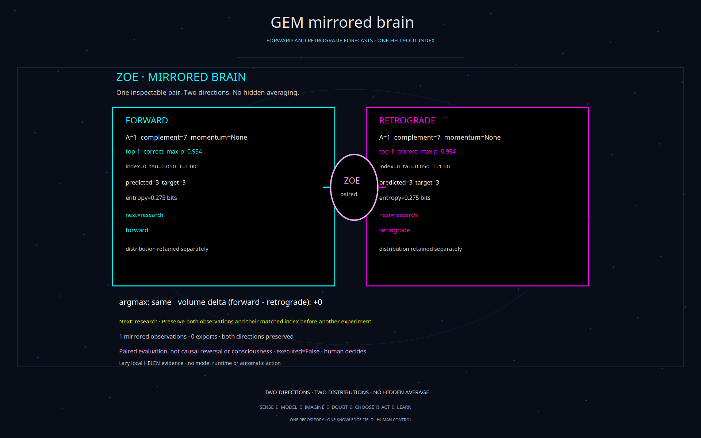

# ZVA-0155 — Zoe Mirror

[Visual archive index](../../README.md) · [Full catalog](../README.md) · [Category: Research figures and measurements](../categories/research-figure.md)

## What this image shows

Zoe's mirrored brain. This figure preserves a measurement, model output, simulation, geometric construction, or research explanation from the Zoe/allgems program.

## Role in Zoe

This figure preserves a measurement, model output, simulation, geometric construction, or research explanation from the Zoe/allgems program.

## Provenance and evidence boundary

**Provenance:** Zoe/allgems project-generated visual.

The image is preserved with its source context; the visual alone does not prove a scientific or operational claim.

## File identity

- Archive ID: **ZVA-0155**
- Visual family: **zoe-mirror**
- Dimensions/format: **1920×1200 PNG**
- Frames: **1**
- Bytes: **135,494**
- SHA-256: `3e43a802acbf7d95b29dd5b1dec1a2362f58f190b81984951796fc108717b391`
- Original file: [Open full resolution](../../images/ZVA-0155.png)

## Source occurrences

Byte-identical copies are archived once while every known source path remains recorded.

| Source repository/collection | Original path | Canonical link |
|---|---|---|
| zoe | `components/Zoe-Autonomy/paper/unified/figures/zoe-mirror.png` | [Source](https://github.com/Ablation-Tool/zoe/blob/main/components/Zoe-Autonomy/paper/unified/figures/zoe-mirror.png) |
| zoe | `components/graphics-environment-manager/docs/images/zoe-mirror.png` | [Source](https://github.com/Ablation-Tool/zoe/blob/main/components/graphics-environment-manager/docs/images/zoe-mirror.png) |
| zoe | `components/next-token-predictability/assets/zoe-mirror.png` | [Source](https://github.com/Ablation-Tool/zoe/blob/main/components/next-token-predictability/assets/zoe-mirror.png) |
| zoe | `components/next-token-predictability/paper/unified/figures/zoe-mirror.png` | [Source](https://github.com/Ablation-Tool/zoe/blob/main/components/next-token-predictability/paper/unified/figures/zoe-mirror.png) |
| zoe-autonomy | `paper/unified/figures/zoe-mirror.png` | [Source](https://github.com/Ablation-Tool/Zoe-Autonomy/blob/main/paper/unified/figures/zoe-mirror.png) |
| next-token | `assets/zoe-mirror.png` | [Source](https://github.com/Ablation-Tool/next-token-predictability/blob/main/assets/zoe-mirror.png) |
| next-token | `paper/unified/figures/zoe-mirror.png` | [Source](https://github.com/Ablation-Tool/next-token-predictability/blob/main/paper/unified/figures/zoe-mirror.png) |
| paper-source-figures | `02-unified-autonomy/figures/zoe-mirror.png` | [Source](https://github.com/Ablation-Tool/research-papers) |

## Documented context

### Zoe OS: one mirrored brain, shared instruments

Source document: `zoe:components/graphics-environment-manager/README.md`

Zoe's mirrored brain

The unified mathematical work now lives here—not in Zoe's `guiai-lab` directory. `python -m gem os` opens a native GTK desktop for paired forward/retrograde HELEN observations, the local GEM manual library, and the Bayesian field notebook. This is a research desktop, not a bootable kernel or a rebuild of the original Digital Research GEM.

## Related format/size variants

- [ZVA-0156](ZVA-0156.md)
