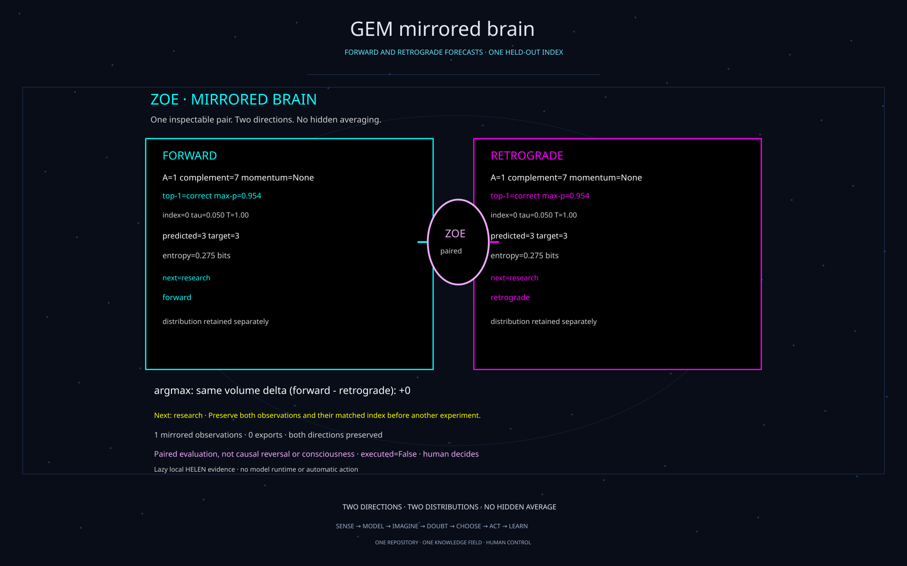

# ZVA-0156 — Zoe Mirror

[Visual archive index](../../README.md) · [Full catalog](../README.md) · [Category: Research figures and measurements](../categories/research-figure.md)

## What this image shows

Zoe Mirror is a research figures and measurements asset from the Zoe-Autonomy portion of the Zoe/allgems project. This figure preserves a measurement, model output, simulation, geometric construction, or research explanation from the Zoe/allgems program.

## Role in Zoe

This figure preserves a measurement, model output, simulation, geometric construction, or research explanation from the Zoe/allgems program.

## Provenance and evidence boundary

**Provenance:** Zoe/allgems project-generated visual.

The image is preserved with its source context; the visual alone does not prove a scientific or operational claim.

## File identity

- Archive ID: **ZVA-0156**
- Visual family: **zoe-mirror**
- Dimensions/format: **SVG 1920×1200**
- Frames: **vector/not applicable**
- Bytes: **27,688**
- SHA-256: `6c4f0932b5ff77965e853afe1b1da15ea5f2f3c332e11f69d6a1d85da8087935`
- Original file: [Open full resolution](../../images/ZVA-0156.svg)

## Source occurrences

Byte-identical copies are archived once while every known source path remains recorded.

| Source repository/collection | Original path | Canonical link |
|---|---|---|
| zoe | `components/Zoe-Autonomy/paper/unified/figures/zoe-mirror.svg` | [Source](https://github.com/Ablation-Tool/zoe/blob/main/components/Zoe-Autonomy/paper/unified/figures/zoe-mirror.svg) |
| zoe | `components/graphics-environment-manager/docs/images/zoe-mirror.svg` | [Source](https://github.com/Ablation-Tool/zoe/blob/main/components/graphics-environment-manager/docs/images/zoe-mirror.svg) |
| zoe | `components/next-token-predictability/assets/zoe-mirror.svg` | [Source](https://github.com/Ablation-Tool/zoe/blob/main/components/next-token-predictability/assets/zoe-mirror.svg) |
| zoe | `components/next-token-predictability/paper/unified/figures/zoe-mirror.svg` | [Source](https://github.com/Ablation-Tool/zoe/blob/main/components/next-token-predictability/paper/unified/figures/zoe-mirror.svg) |
| zoe-autonomy | `paper/unified/figures/zoe-mirror.svg` | [Source](https://github.com/Ablation-Tool/Zoe-Autonomy/blob/main/paper/unified/figures/zoe-mirror.svg) |
| next-token | `assets/zoe-mirror.svg` | [Source](https://github.com/Ablation-Tool/next-token-predictability/blob/main/assets/zoe-mirror.svg) |
| next-token | `paper/unified/figures/zoe-mirror.svg` | [Source](https://github.com/Ablation-Tool/next-token-predictability/blob/main/paper/unified/figures/zoe-mirror.svg) |
| paper-source-figures | `02-unified-autonomy/figures/zoe-mirror.svg` | [Source](https://github.com/Ablation-Tool/research-papers) |

## Related format/size variants

- [ZVA-0155](ZVA-0155.md)
