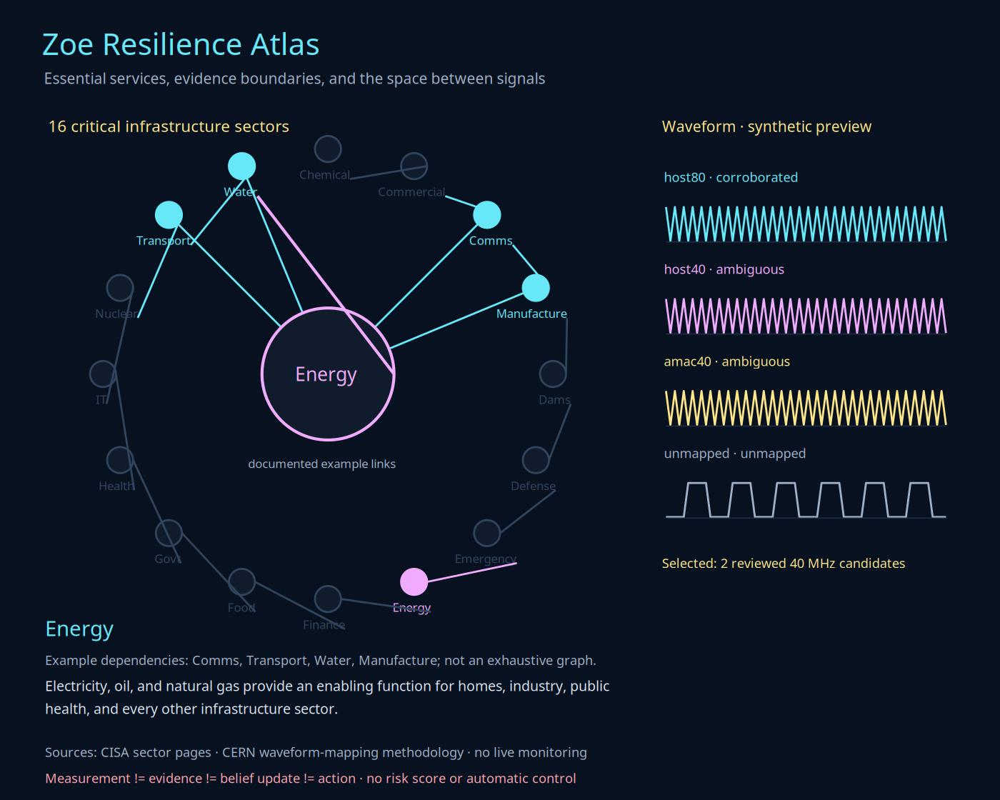

# ZVA-0157 — Zoe Resilience

[Visual archive index](../../README.md) · [Full catalog](../README.md) · [Category: Research figures and measurements](../categories/research-figure.md)

## What this image shows

Resilience Atlas sector and waveform evidence. This figure preserves a measurement, model output, simulation, geometric construction, or research explanation from the Zoe/allgems program.

## Role in Zoe

This figure preserves a measurement, model output, simulation, geometric construction, or research explanation from the Zoe/allgems program.

## Provenance and evidence boundary

**Provenance:** Zoe/allgems project-generated visual.

The image is preserved with its source context; the visual alone does not prove a scientific or operational claim.

## File identity

- Archive ID: **ZVA-0157**
- Visual family: **zoe-resilience**
- Dimensions/format: **1400×1120 PNG**
- Frames: **1**
- Bytes: **183,453**
- SHA-256: `214dc20294a510424cd07f246f751ac613f225ee8f6a405e0727432a0e9f44d5`
- Original file: [Open full resolution](../../images/ZVA-0157.png)

## Source occurrences

Byte-identical copies are archived once while every known source path remains recorded.

| Source repository/collection | Original path | Canonical link |
|---|---|---|
| zoe | `components/Zoe-Autonomy/paper/unified/figures/zoe-resilience.png` | [Source](https://github.com/Ablation-Tool/zoe/blob/main/components/Zoe-Autonomy/paper/unified/figures/zoe-resilience.png) |
| zoe | `components/next-token-predictability/paper/unified/figures/zoe-resilience.png` | [Source](https://github.com/Ablation-Tool/zoe/blob/main/components/next-token-predictability/paper/unified/figures/zoe-resilience.png) |
| zoe-autonomy | `paper/unified/figures/zoe-resilience.png` | [Source](https://github.com/Ablation-Tool/Zoe-Autonomy/blob/main/paper/unified/figures/zoe-resilience.png) |
| next-token | `paper/unified/figures/zoe-resilience.png` | [Source](https://github.com/Ablation-Tool/next-token-predictability/blob/main/paper/unified/figures/zoe-resilience.png) |

## Documented context

### Geometry and evidence

Source document: `zoe:research/papers/zoe-research/docs/native/VISUAL-GUIDES.md`

Resilience Atlas sector and waveform evidence

HELIOS virtual collider laboratory{width=72%} **Zoe Resilience Atlas**

### 12. Zoe resilience

Source document: `zoe:research/papers/galleries/zoe-cern/README.md`

CERN research in Zoe — Visual research index: Zoe resilience

`assets/native/zoe-resilience.png`

### 76. Zoe resilience

Source document: `zoe:research/papers/galleries/zoe-research/README.md`

Complete Zoe research asset index: Zoe resilience

`assets/native/zoe-resilience.png`

### Geometry and evidence

Source document: `zoe:guiai-lab/docs/VISUAL-GUIDES.md`

Resilience Atlas sector and waveform evidence

HELIOS virtual collider laboratory{width=72%} **Zoe Resilience Atlas**

## Related format/size variants

- [ZVA-0019](ZVA-0019.md)
- [ZVA-0020](ZVA-0020.md)
- [ZVA-0417](ZVA-0417.md)
- [ZVA-0418](ZVA-0418.md)
