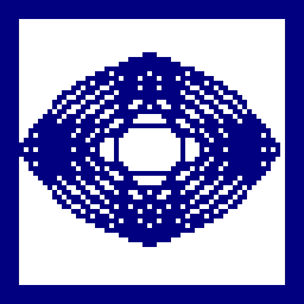

# ZVA-0167 — GEM Woven Diamond

[Visual archive index](../../README.md) · [Full catalog](../README.md) · [Category: Artwork and generative compositions](../categories/artwork.md)

## What this image shows

An original GEM woven-diamond geometric ornament, preserving the project’s interest in executable Spatial IR and decorative mathematical structure. This is part of Zoe’s creative geometry and generative-art practice, preserving the artistic side of the project alongside its scientific instruments.

## Role in Zoe

This is part of Zoe’s creative geometry and generative-art practice, preserving the artistic side of the project alongside its scientific instruments.

## Provenance and evidence boundary

**Provenance:** Project identity or interface asset.

Functional and identity artwork does not constitute research evidence.

## File identity

- Archive ID: **ZVA-0167**
- Visual family: **gem-woven-diamond**
- Dimensions/format: **512×512 PNG**
- Frames: **1**
- Bytes: **2,344**
- SHA-256: `3dbc374805de10eb98fd110319679693767236b27e6195c8f7e403acf80f2807`
- Original file: [Open full resolution](../../images/ZVA-0167.png)

## Source occurrences

Byte-identical copies are archived once while every known source path remains recorded.

| Source repository/collection | Original path | Canonical link |
|---|---|---|
| zoe | `components/ablation/assets/branding/woven-diamond/linux/hicolor/512x512/apps/gem-woven-diamond.png` | [Source](https://github.com/Ablation-Tool/zoe/blob/main/components/ablation/assets/branding/woven-diamond/linux/hicolor/512x512/apps/gem-woven-diamond.png) |
| zoe | `components/ablation/assets/branding/woven-diamond/macos/gem-woven-diamond.iconset/icon_256x256@2x.png` | [Source](https://github.com/Ablation-Tool/zoe/blob/main/components/ablation/assets/branding/woven-diamond/macos/gem-woven-diamond.iconset/icon_256x256%402x.png) |
| zoe | `components/ablation/assets/branding/woven-diamond/macos/gem-woven-diamond.iconset/icon_512x512.png` | [Source](https://github.com/Ablation-Tool/zoe/blob/main/components/ablation/assets/branding/woven-diamond/macos/gem-woven-diamond.iconset/icon_512x512.png) |
| zoe | `components/ablation/assets/branding/woven-diamond/png/gem-woven-diamond-512x512.png` | [Source](https://github.com/Ablation-Tool/zoe/blob/main/components/ablation/assets/branding/woven-diamond/png/gem-woven-diamond-512x512.png) |
| zoe | `components/ablation/assets/branding/woven-diamond/repo/logo.png` | [Source](https://github.com/Ablation-Tool/zoe/blob/main/components/ablation/assets/branding/woven-diamond/repo/logo.png) |
| zoe | `components/ablation/assets/branding/woven-diamond/web/android-chrome-512x512.png` | [Source](https://github.com/Ablation-Tool/zoe/blob/main/components/ablation/assets/branding/woven-diamond/web/android-chrome-512x512.png) |
| zoe | `components/ablation/gem-lab/gem/icons/gem-woven-diamond.png` | [Source](https://github.com/Ablation-Tool/zoe/blob/main/components/ablation/gem-lab/gem/icons/gem-woven-diamond.png) |

## Documented context

### 95. Gem woven diamond

Source document: `zoe:research/papers/galleries/zoe-research/README.md`

Complete Zoe research asset index: Gem woven diamond

`assets/neurogarden/gem-woven-diamond.png`

### components/ablation/README.md

Source document: `zoe:components/ablation/README.md`

Ablation GEM woven diamond

### components/ablation/docs/i18n/ar/README.md

Source document: `zoe:components/ablation/docs/i18n/ar/README.md`

Ablation GEM woven diamond

### components/ablation/docs/i18n/de/README.md

Source document: `zoe:components/ablation/docs/i18n/de/README.md`

Ablation GEM woven diamond

### components/ablation/docs/i18n/es/README.md

Source document: `zoe:components/ablation/docs/i18n/es/README.md`

Ablation GEM woven diamond

### components/ablation/docs/i18n/fr/README.md

Source document: `zoe:components/ablation/docs/i18n/fr/README.md`

Ablation GEM woven diamond

### components/ablation/docs/i18n/hi/README.md

Source document: `zoe:components/ablation/docs/i18n/hi/README.md`

Ablation GEM woven diamond

### components/ablation/docs/i18n/id/README.md

Source document: `zoe:components/ablation/docs/i18n/id/README.md`

Ablation GEM woven diamond

### components/ablation/docs/i18n/it/README.md

Source document: `zoe:components/ablation/docs/i18n/it/README.md`

Ablation GEM woven diamond

### components/ablation/docs/i18n/ja/README.md

Source document: `zoe:components/ablation/docs/i18n/ja/README.md`

Ablation GEM woven diamond

### components/ablation/docs/i18n/ko/README.md

Source document: `zoe:components/ablation/docs/i18n/ko/README.md`

Ablation GEM woven diamond

### components/ablation/docs/i18n/nl/README.md

Source document: `zoe:components/ablation/docs/i18n/nl/README.md`

Ablation GEM woven diamond

### components/ablation/docs/i18n/pl/README.md

Source document: `zoe:components/ablation/docs/i18n/pl/README.md`

Ablation GEM woven diamond

### components/ablation/docs/i18n/pt-BR/README.md

Source document: `zoe:components/ablation/docs/i18n/pt-BR/README.md`

Ablation GEM woven diamond

### components/ablation/docs/i18n/ru/README.md

Source document: `zoe:components/ablation/docs/i18n/ru/README.md`

Ablation GEM woven diamond

### components/ablation/docs/i18n/tr/README.md

Source document: `zoe:components/ablation/docs/i18n/tr/README.md`

Ablation GEM woven diamond

### components/ablation/docs/i18n/vi/README.md

Source document: `zoe:components/ablation/docs/i18n/vi/README.md`

Ablation GEM woven diamond

### components/ablation/docs/i18n/zh/README.md

Source document: `zoe:components/ablation/docs/i18n/zh/README.md`

Ablation GEM woven diamond

## Related format/size variants

- [ZVA-0161](ZVA-0161.md)
- [ZVA-0162](ZVA-0162.md)
- [ZVA-0163](ZVA-0163.md)
- [ZVA-0164](ZVA-0164.md)
- [ZVA-0165](ZVA-0165.md)
- [ZVA-0166](ZVA-0166.md)
- [ZVA-0168](ZVA-0168.md)
- [ZVA-0169](ZVA-0169.md)
- [ZVA-0244](ZVA-0244.md)
