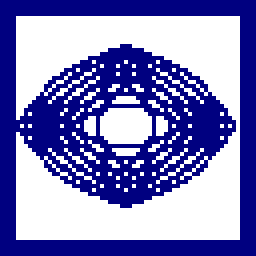

# ZVA-0169 — GEM Woven Diamond

[Visual archive index](../../README.md) · [Full catalog](../README.md) · [Category: Artwork and generative compositions](../categories/artwork.md)

## What this image shows

An original GEM woven-diamond geometric ornament, preserving the project’s interest in executable Spatial IR and decorative mathematical structure. This is part of Zoe’s creative geometry and generative-art practice, preserving the artistic side of the project alongside its scientific instruments.

## Role in Zoe

This is part of Zoe’s creative geometry and generative-art practice, preserving the artistic side of the project alongside its scientific instruments.

## Provenance and evidence boundary

**Provenance:** Project identity or interface asset.

Functional and identity artwork does not constitute research evidence.

## File identity

- Archive ID: **ZVA-0169**
- Visual family: **gem-woven-diamond**
- Dimensions/format: **SVG 256×256**
- Frames: **vector/not applicable**
- Bytes: **3,781**
- SHA-256: `93bedf094bea46806ae94dbd1a699b8bcfdd8163b76003d7edddfb188b21c6d5`
- Original file: [Open full resolution](../../images/ZVA-0169.svg)

## Source occurrences

Byte-identical copies are archived once while every known source path remains recorded.

| Source repository/collection | Original path | Canonical link |
|---|---|---|
| zoe | `components/ablation/assets/branding/woven-diamond/linux/hicolor/scalable/apps/gem-woven-diamond.svg` | [Source](https://github.com/Ablation-Tool/zoe/blob/main/components/ablation/assets/branding/woven-diamond/linux/hicolor/scalable/apps/gem-woven-diamond.svg) |
| zoe | `components/ablation/assets/branding/woven-diamond/repo/logo.svg` | [Source](https://github.com/Ablation-Tool/zoe/blob/main/components/ablation/assets/branding/woven-diamond/repo/logo.svg) |
| zoe | `components/ablation/assets/branding/woven-diamond/source/gem-woven-diamond.svg` | [Source](https://github.com/Ablation-Tool/zoe/blob/main/components/ablation/assets/branding/woven-diamond/source/gem-woven-diamond.svg) |
| zoe | `components/ablation/assets/branding/woven-diamond/web/favicon.svg` | [Source](https://github.com/Ablation-Tool/zoe/blob/main/components/ablation/assets/branding/woven-diamond/web/favicon.svg) |
| zoe | `components/ablation/gem-lab/gem/icons/gem-woven-diamond.svg` | [Source](https://github.com/Ablation-Tool/zoe/blob/main/components/ablation/gem-lab/gem/icons/gem-woven-diamond.svg) |

## Related format/size variants

- [ZVA-0161](ZVA-0161.md)
- [ZVA-0162](ZVA-0162.md)
- [ZVA-0163](ZVA-0163.md)
- [ZVA-0164](ZVA-0164.md)
- [ZVA-0165](ZVA-0165.md)
- [ZVA-0166](ZVA-0166.md)
- [ZVA-0167](ZVA-0167.md)
- [ZVA-0168](ZVA-0168.md)
- [ZVA-0244](ZVA-0244.md)
