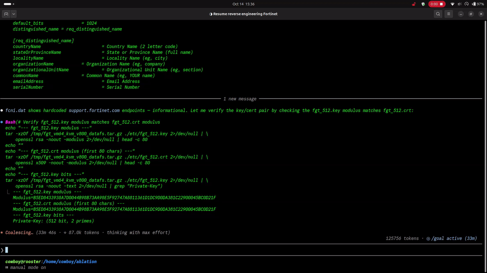

# ZVA-0177 — Learn As You Re

[Visual archive index](../../README.md) · [Full catalog](../README.md) · [Category: Animations and historical motion assets](../categories/animation.md)

## What this image shows

A recorded Learn As You Re demonstration animation showing the associated project workflow and interface in motion. This historical motion asset is retained as part of the project’s visual provenance, including duplicate-name and duplicate-content relationships.

## Role in Zoe

This historical motion asset is retained as part of the project’s visual provenance, including duplicate-name and duplicate-content relationships.

## Provenance and evidence boundary

**Provenance:** User-supplied historical motion asset.

The supplied GIF names must not be interpreted as distinct animations when their bytes are identical.

## File identity

- Archive ID: **ZVA-0177**
- Visual family: **learn-as-you-re**
- Dimensions/format: **1280×720 GIF**
- Frames: **392**
- Bytes: **7,300,884**
- SHA-256: `a964280f4993ffbb99f22bb34e81cdeb87bad545f411c83ddd6ab5e49452d923`
- Original file: [Open full resolution](../../images/ZVA-0177.gif)

## Source occurrences

Byte-identical copies are archived once while every known source path remains recorded.

| Source repository/collection | Original path | Canonical link |
|---|---|---|
| zoe | `components/ablation/assets/demos/Learn-As-You-RE.gif` | [Source](https://github.com/Ablation-Tool/zoe/blob/main/components/ablation/assets/demos/Learn-As-You-RE.gif) |
