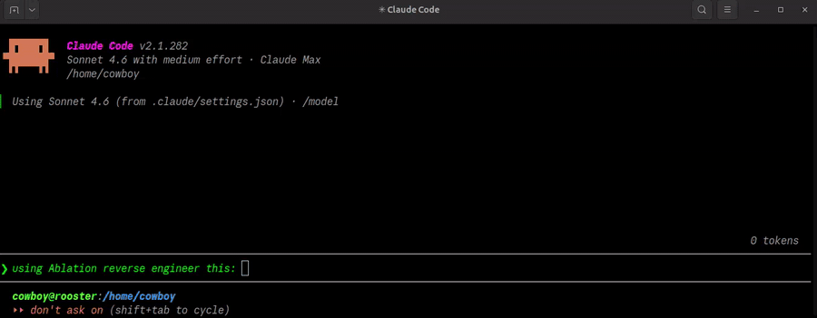

# ZVA-0178 — Claude Code Demo

[Visual archive index](../../README.md) · [Full catalog](../README.md) · [Category: Animations and historical motion assets](../categories/animation.md)

## What this image shows

A recorded Claude Code Demo demonstration animation showing the associated project workflow and interface in motion. This historical motion asset is retained as part of the project’s visual provenance, including duplicate-name and duplicate-content relationships.

## Role in Zoe

This historical motion asset is retained as part of the project’s visual provenance, including duplicate-name and duplicate-content relationships.

## Provenance and evidence boundary

**Provenance:** User-supplied historical motion asset.

The supplied GIF names must not be interpreted as distinct animations when their bytes are identical.

## File identity

- Archive ID: **ZVA-0178**
- Visual family: **claude-code-demo**
- Dimensions/format: **900×351 GIF**
- Frames: **316**
- Bytes: **540,028**
- SHA-256: `5331cc528f5b6775079a0eefe150eca1b4c69d96fb93669614b0210a014ac99d`
- Original file: [Open full resolution](../../images/ZVA-0178.gif)

## Source occurrences

Byte-identical copies are archived once while every known source path remains recorded.

| Source repository/collection | Original path | Canonical link |
|---|---|---|
| zoe | `components/ablation/assets/demos/claude-code-demo.gif` | [Source](https://github.com/Ablation-Tool/zoe/blob/main/components/ablation/assets/demos/claude-code-demo.gif) |
| zoe | `components/ablation/assets/demos/screencast-2026-09-30.gif` | [Source](https://github.com/Ablation-Tool/zoe/blob/main/components/ablation/assets/demos/screencast-2026-09-30.gif) |

## Documented context

### components/ablation/docs/i18n/ar/README.md

Source document: `zoe:components/ablation/docs/i18n/ar/README.md`

عرض Codex

بالدمج مع Claude Code أو OpenAI Codex، يتحول إلى أداة هندسة عكسية مستقلة. ---

### components/ablation/docs/i18n/de/README.md

Source document: `zoe:components/ablation/docs/i18n/de/README.md`

Codex-Demo

In Kombination mit Claude Code oder OpenAI Codex wird es zu einem autonomen Reverse-Engineering-Tool. ---

### components/ablation/docs/i18n/es/README.md

Source document: `zoe:components/ablation/docs/i18n/es/README.md`

Demo de Codex

Combinado con Claude Code u OpenAI Codex, se convierte en una herramienta de ingeniería inversa autónoma. ---

### components/ablation/docs/i18n/fr/README.md

Source document: `zoe:components/ablation/docs/i18n/fr/README.md`

Démo Codex

Combiné avec Claude Code ou OpenAI Codex, il devient un outil de rétro-ingénierie autonome. ---

### components/ablation/docs/i18n/hi/README.md

Source document: `zoe:components/ablation/docs/i18n/hi/README.md`

Codex डेमो

Claude Code या OpenAI Codex के साथ मिलाने पर यह एक पूर्ण स्वायत्त रिवर्स इंजीनियरिंग टूल बन जाता है। ---

### components/ablation/docs/i18n/id/README.md

Source document: `zoe:components/ablation/docs/i18n/id/README.md`

Demo Codex

Dikombinasikan dengan Claude Code atau OpenAI Codex, ia menjadi alat rekayasa terbalik yang sepenuhnya otonom. ---

### components/ablation/docs/i18n/it/README.md

Source document: `zoe:components/ablation/docs/i18n/it/README.md`

Demo di Codex

Combinato con Claude Code o OpenAI Codex, diventa uno strumento di reverse engineering completamente autonomo. ---

### components/ablation/docs/i18n/ja/README.md

Source document: `zoe:components/ablation/docs/i18n/ja/README.md`

Codexデモ

Claude CodeまたはOpenAI Codexと組み合わせることで、自律的なリバースエンジニアリングツールになります。 ---

### components/ablation/docs/i18n/ko/README.md

Source document: `zoe:components/ablation/docs/i18n/ko/README.md`

Codex 데모

Claude Code 또는 OpenAI Codex와 결합하면 완전 자율 리버스 엔지니어링 도구로 전환됩니다. ---

### components/ablation/docs/i18n/nl/README.md

Source document: `zoe:components/ablation/docs/i18n/nl/README.md`

Codex demo

Gecombineerd met Claude Code of OpenAI Codex wordt het een volledig autonoom reverse engineering tool. ---

### components/ablation/docs/i18n/pl/README.md

Source document: `zoe:components/ablation/docs/i18n/pl/README.md`

Demo Codex

W połączeniu z Claude Code lub OpenAI Codex staje się w pełni autonomicznym narzędziem inżynierii wstecznej. ---

### components/ablation/docs/i18n/pt-BR/README.md

Source document: `zoe:components/ablation/docs/i18n/pt-BR/README.md`

Demo do Codex

Combinado com Claude Code ou OpenAI Codex, se transforma em uma ferramenta de engenharia reversa autônoma. ---

### components/ablation/docs/i18n/ru/README.md

Source document: `zoe:components/ablation/docs/i18n/ru/README.md`

Демо Codex

В сочетании с Claude Code или OpenAI Codex он становится автономным инструментом для реверс-инжиниринга. ---

### components/ablation/docs/i18n/tr/README.md

Source document: `zoe:components/ablation/docs/i18n/tr/README.md`

Codex demosu

Claude Code veya OpenAI Codex ile birleştirildiğinde tam otonom bir tersine mühendislik aracına dönüşür. ---

### components/ablation/docs/i18n/vi/README.md

Source document: `zoe:components/ablation/docs/i18n/vi/README.md`

Demo Codex

Kết hợp với Claude Code hoặc OpenAI Codex, nó trở thành một công cụ dịch ngược hoàn toàn tự động. ---

### components/ablation/docs/i18n/zh/README.md

Source document: `zoe:components/ablation/docs/i18n/zh/README.md`

Codex 演示

与 Claude Code 或 OpenAI Codex 结合后，它可以成为自主逆向工程工具。 ---
