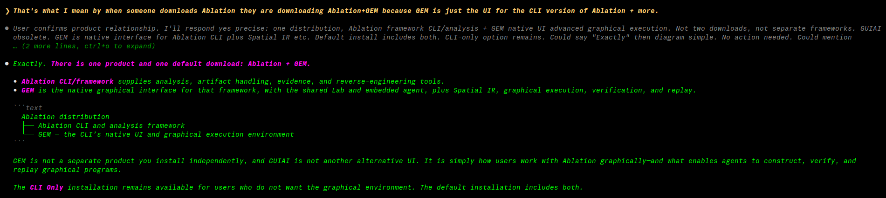

# ZVA-0183 — GEM Architecture 05

[Visual archive index](../../README.md) · [Full catalog](../README.md) · [Category: Mechanism and architecture diagrams](../categories/mechanism-diagram.md)

## What this image shows

One Ablation and GEM (Graphics Environment Manager) distribution with a CLI Only option. This diagram explains relationships among components, evidence states, measurements, or decisions without requiring the reader to reconstruct the architecture from code.

## Role in Zoe

This diagram explains relationships among components, evidence states, measurements, or decisions without requiring the reader to reconstruct the architecture from code.

## Provenance and evidence boundary

**Provenance:** Zoe/allgems project-generated visual.

The image is preserved with its source context; the visual alone does not prove a scientific or operational claim.

## File identity

- Archive ID: **ZVA-0183**
- Visual family: **gem-architecture-05**
- Dimensions/format: **1901×426 PNG**
- Frames: **1**
- Bytes: **84,184**
- SHA-256: `d0f446409d80a1792c2758f1773e4324e0cae5ba0d3a45a666638d2608fea3a5`
- Original file: [Open full resolution](../../images/ZVA-0183.png)

## Source occurrences

Byte-identical copies are archived once while every known source path remains recorded.

| Source repository/collection | Original path | Canonical link |
|---|---|---|
| zoe | `components/ablation/assets/demos/gem-architecture-05.png` | [Source](https://github.com/Ablation-Tool/zoe/blob/main/components/ablation/assets/demos/gem-architecture-05.png) |

## Documented context

### Ablation + GEM (Graphics Environment Manager) architecture notes

Source document: `zoe:components/ablation/README.md`

One Ablation and GEM (Graphics Environment Manager) distribution with a CLI Only option
