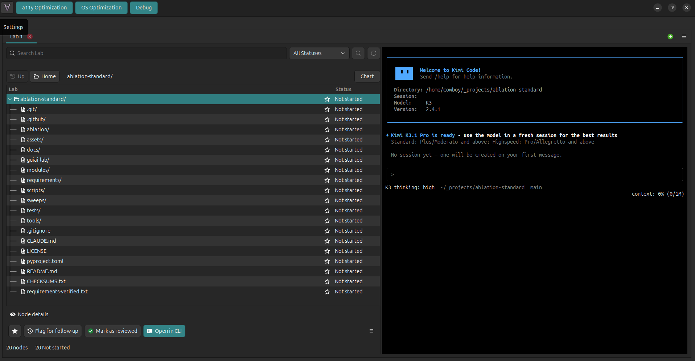

# ZVA-0185 — GEM Demo 02

[Visual archive index](../../README.md) · [Full catalog](../README.md) · [Category: Native interfaces and application scenes](../categories/interface.md)

## What this image shows

GEM settings controls and optimization buttons. This image documents a native, mobile, browser, or desktop interface and its available controls at a particular recorded state.

## Role in Zoe

This image documents a native, mobile, browser, or desktop interface and its available controls at a particular recorded state.

## Provenance and evidence boundary

**Provenance:** Zoe/allgems project-generated visual.

The image is preserved with its source context; the visual alone does not prove a scientific or operational claim.

## File identity

- Archive ID: **ZVA-0185**
- Visual family: **gem-demo-02**
- Dimensions/format: **1916×998 PNG**
- Frames: **1**
- Bytes: **146,130**
- SHA-256: `244ca28ac33dd4a4a8b63e119e82e9f8908bc00cf8eebcefea56d98539e53921`
- Original file: [Open full resolution](../../images/ZVA-0185.png)

## Source occurrences

Byte-identical copies are archived once while every known source path remains recorded.

| Source repository/collection | Original path | Canonical link |
|---|---|---|
| zoe | `components/ablation/assets/demos/gem-demo-02.png` | [Source](https://github.com/Ablation-Tool/zoe/blob/main/components/ablation/assets/demos/gem-demo-02.png) |

## Documented context

### GEM (Graphics Environment Manager) Workbench

Source document: `zoe:components/ablation/README.md`

GEM settings controls and optimization buttons
