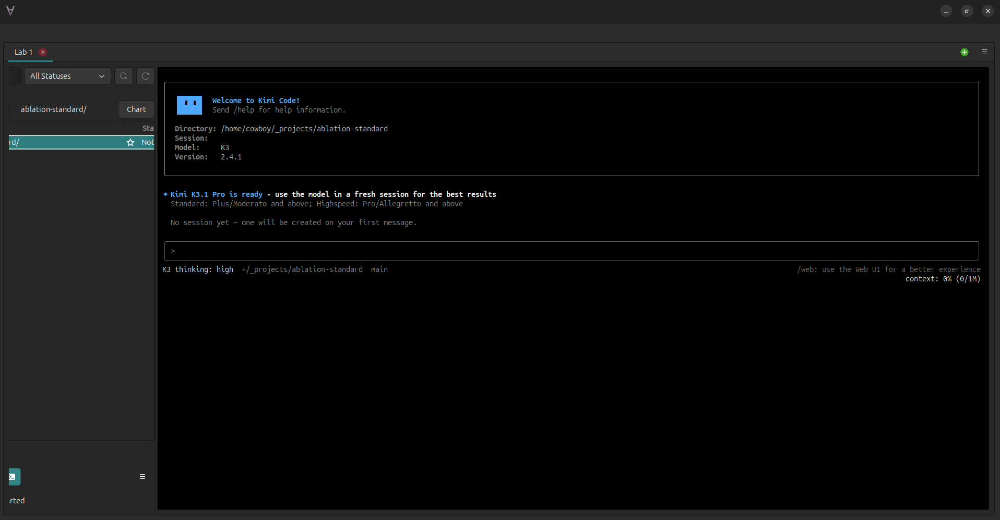

# ZVA-0196 — GEM Demo 13

[Visual archive index](../../README.md) · [Full catalog](../README.md) · [Category: Native interfaces and application scenes](../categories/interface.md)

## What this image shows

Expanded embedded AI terminal workspace. This image documents a native, mobile, browser, or desktop interface and its available controls at a particular recorded state.

## Role in Zoe

This image documents a native, mobile, browser, or desktop interface and its available controls at a particular recorded state.

## Provenance and evidence boundary

**Provenance:** Zoe/allgems project-generated visual.

The image is preserved with its source context; the visual alone does not prove a scientific or operational claim.

## File identity

- Archive ID: **ZVA-0196**
- Visual family: **gem-demo-13**
- Dimensions/format: **1916×998 PNG**
- Frames: **1**
- Bytes: **68,543**
- SHA-256: `55d3cd020021edd9fe697bf8edccfccf37e1e333862881fe2ebb4911a337e8cd`
- Original file: [Open full resolution](../../images/ZVA-0196.png)

## Source occurrences

Byte-identical copies are archived once while every known source path remains recorded.

| Source repository/collection | Original path | Canonical link |
|---|---|---|
| zoe | `components/ablation/assets/demos/gem-demo-13.png` | [Source](https://github.com/Ablation-Tool/zoe/blob/main/components/ablation/assets/demos/gem-demo-13.png) |

## Documented context

### GEM (Graphics Environment Manager) Workbench

Source document: `zoe:components/ablation/README.md`

Expanded embedded AI terminal workspace
