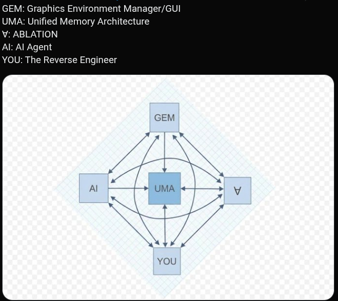

# ZVA-0208 — GEM Unified Memory Architecture

[Visual archive index](../../README.md) · [Full catalog](../README.md) · [Category: Mechanism and architecture diagrams](../categories/mechanism-diagram.md)

## What this image shows

Unified Memory Architecture: human, AI Agent, Ablation, and GEM. This diagram explains relationships among components, evidence states, measurements, or decisions without requiring the reader to reconstruct the architecture from code.

## Role in Zoe

This diagram explains relationships among components, evidence states, measurements, or decisions without requiring the reader to reconstruct the architecture from code.

## Provenance and evidence boundary

**Provenance:** Zoe/allgems project-generated visual.

The image is preserved with its source context; the visual alone does not prove a scientific or operational claim.

## File identity

- Archive ID: **ZVA-0208**
- Visual family: **gem-unified-memory-architecture**
- Dimensions/format: **659×587 PNG**
- Frames: **1**
- Bytes: **290,990**
- SHA-256: `99ea24bb8fdd241c57459f8d7ca9cdda504e3d97b6ee431826635f7143c69b76`
- Original file: [Open full resolution](../../images/ZVA-0208.png)

## Source occurrences

Byte-identical copies are archived once while every known source path remains recorded.

| Source repository/collection | Original path | Canonical link |
|---|---|---|
| zoe | `components/ablation/assets/demos/gem-unified-memory-architecture.png` | [Source](https://github.com/Ablation-Tool/zoe/blob/main/components/ablation/assets/demos/gem-unified-memory-architecture.png) |

## Documented context

### Ablation + GEM (Graphics Environment Manager)

Source document: `zoe:components/ablation/README.md`

Unified Memory Architecture: human, AI Agent, Ablation, and GEM

**Ablation + GEM (Graphics Environment Manager) is one product and one default download.** Ablation supplies the required CLI, analysis framework, artifact parsers, reverse-engineering tools, target context, and evidence model. GEM (Graphics Environment Manager) is the native UI for that framework, with the shared investigation Lab, embedded AI Agent, Spatial IR, graphical execution, deterministic verification, and replayable visual evidence. Ablation can operate CLI-only. GEM's complete investigation workflows require Ablation. The default installation includes both; **CLI Only** remains available for users who do not want a graphical environment. The former GUIAI is obsolete, not an alternate interface or supported alias.

### Environment and hosted Lab

Source document: `zoe:components/graphics-environment-manager/GEM.md`

Unified Memory Architecture: human, AI Agent, Ablation, and GEM

- `gem lab TARGET --session SESSION` opens the existing native Lab through the GEM entry point. Agent and toolkit options delegate to the same Lab application protocol. - `gem lab-state --session SESSION` exposes authoritative investigation state and the derived spatial projection as inspectable JSON. - `investigation:ID` addresses real event objects. `spatial:SCENE:OBJECT` addresses generated graphical objects and links them back to `event_id` where applicable. - The broker supports snapshot, resolve, revision-checked select/begin, and replayed export operations. GTK export and the host use the same service code.

### Environment and hosted Lab

Source document: `zoe:components/ablation/gem-lab/GEM.md`

Unified Memory Architecture: human, AI Agent, Ablation, and GEM

- `gem lab TARGET --session SESSION` opens the existing native Lab through the GEM entry point. Agent and toolkit options delegate to the same Lab application protocol. - `gem lab-state --session SESSION` exposes authoritative investigation state and the derived spatial projection as inspectable JSON. - `investigation:ID` addresses real event objects. `spatial:SCENE:OBJECT` addresses generated graphical objects and links them back to `event_id` where applicable. - The broker supports snapshot, resolve, revision-checked select/begin, and replayed export operations. GTK export and the host use the same service code.
