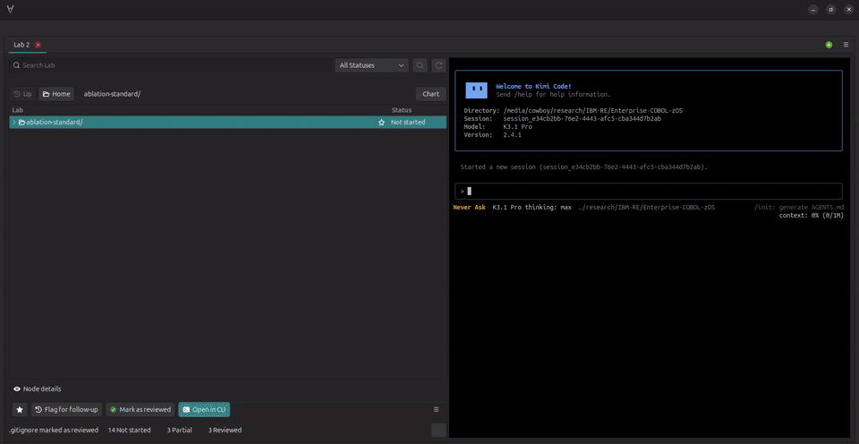

# ZVA-0209 — GEM Workbench Demo

[Visual archive index](../../README.md) · [Full catalog](../README.md) · [Category: Animations and historical motion assets](../categories/animation.md)

## What this image shows

A recorded GEM Workbench Demo demonstration animation showing the associated project workflow and interface in motion. This historical motion asset is retained as part of the project’s visual provenance, including duplicate-name and duplicate-content relationships.

## Role in Zoe

This historical motion asset is retained as part of the project’s visual provenance, including duplicate-name and duplicate-content relationships.

## Provenance and evidence boundary

**Provenance:** User-supplied historical motion asset.

The supplied GIF names must not be interpreted as distinct animations when their bytes are identical.

## File identity

- Archive ID: **ZVA-0209**
- Visual family: **gem-workbench-demo**
- Dimensions/format: **960×496 GIF**
- Frames: **2297**
- Bytes: **12,835,349**
- SHA-256: `11592738d1221fd2fcc7b0445d4fbcd78b1e4c30887b6ca073d127434c662095`
- Original file: [Open full resolution](../../images/ZVA-0209.gif)

## Source occurrences

Byte-identical copies are archived once while every known source path remains recorded.

| Source repository/collection | Original path | Canonical link |
|---|---|---|
| zoe | `components/ablation/assets/demos/gem-workbench-demo.gif` | [Source](https://github.com/Ablation-Tool/zoe/blob/main/components/ablation/assets/demos/gem-workbench-demo.gif) |

## Documented context

### components/ablation/README.md

Source document: `zoe:components/ablation/README.md`

GEM native workbench demo

Ablation is fully integrated into the unified Zoe research system, where it supplies executable-artifact semantics to Zoe's perception, reasoning, memory, and guarded action loop. It also remains an independent reverse-engineering project at `https://github.com/Ablation-Tool/ablation`. See Zoe's capability atlas and AGI/ASI roadmap. ---
