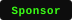

# ZVA-0210 — Sponsor Badge

[Visual archive index](../../README.md) · [Full catalog](../README.md) · [Category: Research figures and measurements](../categories/research-figure.md)

## What this image shows

Sponsor Badge is a research figures and measurements asset from the ablation portion of the Zoe/allgems project. This figure preserves a measurement, model output, simulation, geometric construction, or research explanation from the Zoe/allgems program.

## Role in Zoe

This figure preserves a measurement, model output, simulation, geometric construction, or research explanation from the Zoe/allgems program.

## Provenance and evidence boundary

**Provenance:** Zoe/allgems project-generated visual.

The image is preserved with its source context; the visual alone does not prove a scientific or operational claim.

## File identity

- Archive ID: **ZVA-0210**
- Visual family: **sponsor-badge**
- Dimensions/format: **SVG 72×20**
- Frames: **vector/not applicable**
- Bytes: **298**
- SHA-256: `f78d3b23d267f58e1a181906371fae25422b1f44310259cf270c07bb137f53b1`
- Original file: [Open full resolution](../../images/ZVA-0210.svg)

## Source occurrences

Byte-identical copies are archived once while every known source path remains recorded.

| Source repository/collection | Original path | Canonical link |
|---|---|---|
| zoe | `components/ablation/docs/sponsor-badge.svg` | [Source](https://github.com/Ablation-Tool/zoe/blob/main/components/ablation/docs/sponsor-badge.svg) |
