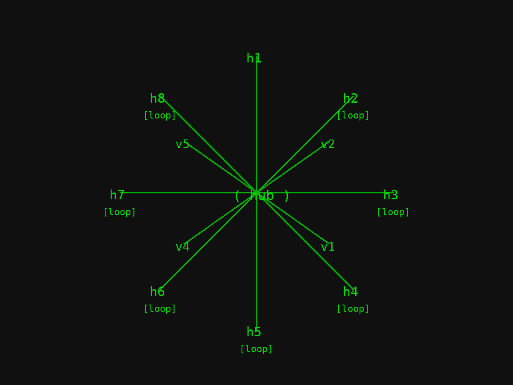

# ZVA-0220 — Hub Loop

[Visual archive index](../../README.md) · [Full catalog](../README.md) · [Category: Source references and derivative reading copies](../categories/reference.md)

## What this image shows

The derived hub-loop mathematical source with eight h nodes and four v nodes around a central hub, used in the reproducible geometry experiment. This asset preserves source context or a derivative reading view so that generated interpretations remain distinguishable from their references.

## Role in Zoe

This asset preserves source context or a derivative reading view so that generated interpretations remain distinguishable from their references.

## Provenance and evidence boundary

**Provenance:** Immutable or derived sacred-geometry experiment source.

These images are source data for mathematical transcription, pixel measurement, and replay; they are not automatically original Zoe artwork.

## File identity

- Archive ID: **ZVA-0220**
- Visual family: **hub-loop**
- Dimensions/format: **1200×900 PNG**
- Frames: **1**
- Bytes: **24,295**
- SHA-256: `d65750a0e0b93de036a5e10f01b1f0786879e1d08818734b9e34884b2f3ac6ab`
- Original file: [Open full resolution](../../images/ZVA-0220.png)

## Source occurrences

Byte-identical copies are archived once while every known source path remains recorded.

| Source repository/collection | Original path | Canonical link |
|---|---|---|
| zoe | `components/ablation/experiments/sacred-geometry/source/hub-loop.png` | [Source](https://github.com/Ablation-Tool/zoe/blob/main/components/ablation/experiments/sacred-geometry/source/hub-loop.png) |

## Related format/size variants

- [ZVA-0221](ZVA-0221.md)
