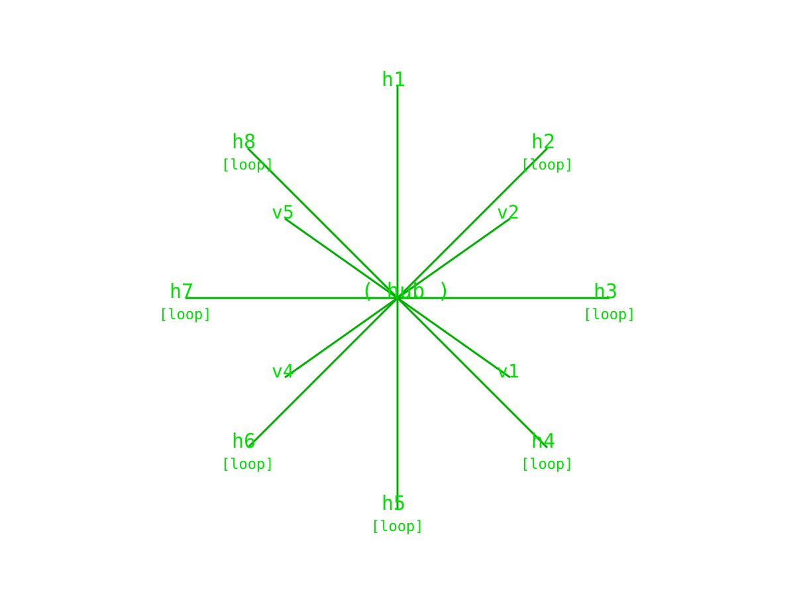

# ZVA-0221 — Hub Loop

[Visual archive index](../../README.md) · [Full catalog](../README.md) · [Category: Source references and derivative reading copies](../categories/reference.md)

## What this image shows

The derived hub-loop mathematical source with eight h nodes and four v nodes around a central hub, used in the reproducible geometry experiment. This asset preserves source context or a derivative reading view so that generated interpretations remain distinguishable from their references.

## Role in Zoe

This asset preserves source context or a derivative reading view so that generated interpretations remain distinguishable from their references.

## Provenance and evidence boundary

**Provenance:** Immutable or derived sacred-geometry experiment source.

These images are source data for mathematical transcription, pixel measurement, and replay; they are not automatically original Zoe artwork.

## File identity

- Archive ID: **ZVA-0221**
- Visual family: **hub-loop**
- Dimensions/format: **SVG 1200×900**
- Frames: **vector/not applicable**
- Bytes: **2,765**
- SHA-256: `0a00dc27b180dc40fa87aa08216349ce783809a5bcfde0b54a4f51dd2233c7d6`
- Original file: [Open full resolution](../../images/ZVA-0221.svg)

## Source occurrences

Byte-identical copies are archived once while every known source path remains recorded.

| Source repository/collection | Original path | Canonical link |
|---|---|---|
| zoe | `components/ablation/experiments/sacred-geometry/source/hub-loop.svg` | [Source](https://github.com/Ablation-Tool/zoe/blob/main/components/ablation/experiments/sacred-geometry/source/hub-loop.svg) |

## Related format/size variants

- [ZVA-0220](ZVA-0220.md)
