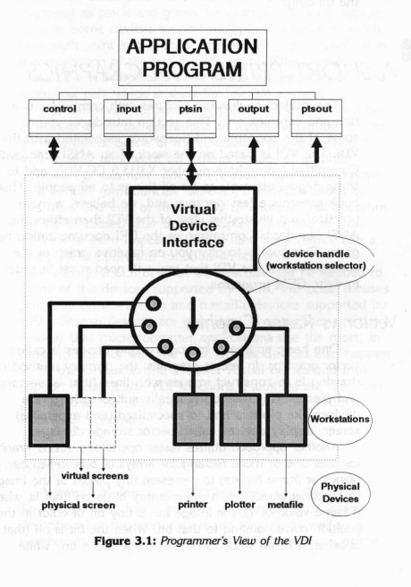

# ZVA-0222 — VDI Bidirectional Interface

[Visual archive index](../../README.md) · [Full catalog](../README.md) · [Category: Source references and derivative reading copies](../categories/reference.md)

<a href="../../images/ZVA-0222.png"></a>

## What this image shows

A historical VDI bidirectional-interface reference image used as an architectural analogy for two-way measurement and feedback. This asset preserves source context or a derivative reading view so that generated interpretations remain distinguishable from their references.

## Role in Zoe

This asset preserves source context or a derivative reading view so that generated interpretations remain distinguishable from their references.

## Provenance and evidence boundary

**Provenance:** Zoe/allgems project-generated visual.

The image is preserved with its source context; the visual alone does not prove a scientific or operational claim.

## File identity

- Archive ID: **ZVA-0222**
- Visual family: **vdi-bidirectional-interface**
- Dimensions/format: **460×656 PNG**
- Frames: **1**
- Bytes: **198,807**
- SHA-256: `eb1df3d2c73ae0799b0381173bd0378f0ba4c08da127885588d22427e2809acd`
- Original file: [Open full resolution](../../images/ZVA-0222.png)

## Source occurrences

Byte-identical copies are archived once while every known source path remains recorded.

| Source repository/collection | Original path | Canonical link |
|---|---|---|
| zoe | `components/ablation/gem-lab/docs/images/vdi-bidirectional-interface.png` | [Source](https://github.com/Ablation-Tool/zoe/blob/main/components/ablation/gem-lab/docs/images/vdi-bidirectional-interface.png) |
| zoe | `guiai-lab/docs/images/vdi-bidirectional-interface.png` | [Source](https://github.com/Ablation-Tool/zoe/blob/main/guiai-lab/docs/images/vdi-bidirectional-interface.png) |


## Documented context

### Operational Metacognition and momentum

Source document: `zoe:guiai-lab/GEM.md`

Programmer's view of the VDI, included as an architectural analogy for the two-way feedback interface

Positive momentum means the forecast broadened; negative momentum means it narrowed. `--previous-key` selects the earlier array independently of `--key`. `--min-volume` and `--max-volume` define a target band. The report can suggest broadening context, narrowing context, letting the current trend continue, or continuing within the band. These are experimental recommendations, not automatic actions or evidence of correctness. `VolumeBridge` provides the same bidirectional flow in Python: each `observe` call measures the present distribution and compares it with the previous one. Forward measurement and backward feedback form a loop, not an algebraic inverse. Accessible and complementary volumes sum to the vocabulary size; forward and reverse momentum sum to zero.

### 19. Vdi bidirectional interface

Source document: `zoe:research/papers/galleries/zoe-research/README.md`

Complete Zoe research asset index: Vdi bidirectional interface

`assets/native/vdi-bidirectional-interface.png`

### NPZ evidence and the two-way bridge

Source document: `zoe:components/ablation/gem-lab/GEM.md`

Programmer's view of the VDI, included as an architectural analogy for the two-way feedback interface

gem volume --probabilities current.npz --previous earlier.npz --tau 0.05 --output artifact.json ``` The key options `--key` and `--previous-key`, and the volume-band options `--min-volume` and `--max-volume`, select the artifact interface when no session is supplied, preserving the original artifact command form. Both interfaces validate the selected distribution and record strict threshold counts and complements. The bridge adds source/probability hashes, a UTC timestamp, monotonic elapsed time, and forward-measurement/backward-guidance feedback. It is a feedback loop, not an algebraic inverse. Accessible and complementary volumes sum to the vocabulary size; forward and reverse momentum sum to zero. All steering is advisory and never executes an action.
