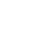

# ZVA-0226 — P Icon Expand Inverse

[Visual archive index](../../README.md) · [Full catalog](../README.md) · [Category: Identity, emblems, and interface icons](../categories/branding.md)

## What this image shows

A compact GEM/GUIAI interface glyph for the “expand inverse” action or state, supplied in the project’s icon set. This visual supports recognition, navigation, application identity, or a cohesive visual language across Zoe and its components.

## Role in Zoe

This visual supports recognition, navigation, application identity, or a cohesive visual language across Zoe and its components.

## Provenance and evidence boundary

**Provenance:** Project identity or interface asset.

Functional and identity artwork does not constitute research evidence.

## File identity

- Archive ID: **ZVA-0226**
- Visual family: **p-icon--expand-inverse**
- Dimensions/format: **32×32 PNG**
- Frames: **1**
- Bytes: **230**
- SHA-256: `869e59b2307d1112e3a73e1d4c26088fdcf44b676a5fa704fe0ee533dc04aa95`
- Original file: [Open full resolution](../../images/ZVA-0226.png)

## Source occurrences

Byte-identical copies are archived once while every known source path remains recorded.

| Source repository/collection | Original path | Canonical link |
|---|---|---|
| zoe | `components/ablation/gem-lab/gem/icons/p-icon--expand-inverse.png` | [Source](https://github.com/Ablation-Tool/zoe/blob/main/components/ablation/gem-lab/gem/icons/p-icon--expand-inverse.png) |
| zoe | `components/graphics-environment-manager/gem/icons/p-icon--expand-inverse.png` | [Source](https://github.com/Ablation-Tool/zoe/blob/main/components/graphics-environment-manager/gem/icons/p-icon--expand-inverse.png) |

## Related format/size variants

- [ZVA-0227](ZVA-0227.md)
